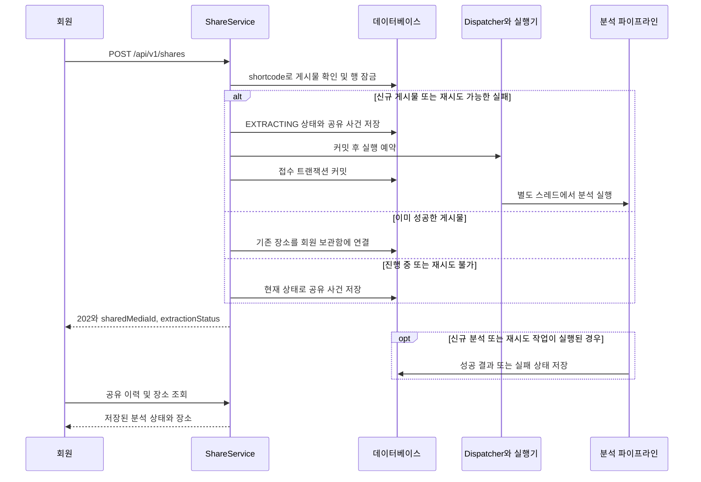
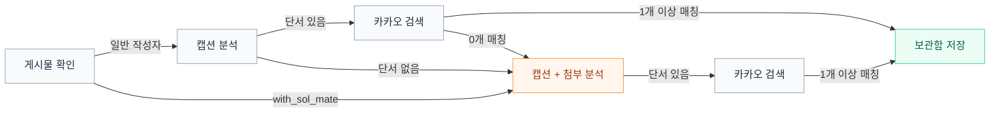

# 장소 분석 파이프라인

인스타그램 게시물에서 장소 검색 단서를 얻고, 카카오 지도에서 찾은 장소를 회원 보관함에 저장하는 흐름이다.
Gemini가 만드는 결과는 검색 단서이고, 최종 장소 이름, 주소, 좌표는 카카오 검색 결과에서 가져온다.

2026-10-17 기준 구현을 설명하며, 현재 파이프라인 버전은 `1`이다.

## 1. 먼저 알아둘 규칙

| 질문 | 현재 동작 |
| --- | --- |
| 모든 게시물을 영상과 이미지까지 분석하는가? | 기본은 캡션 우선이다. 캡션에서 장소 단서가 0개이거나, 캡션 단서로 카카오에서 장소를 한 곳도 찾지 못했을 때만 첨부 분석을 실행한다. |
| 예외가 있는가? | 작성자 핸들이 정확히 `with_sol_mate`이면 처음부터 캡션과 전체 첨부를 함께 분석한다. |
| 캡션에서 찾은 장소가 지도에 없으면 첨부 분석을 하는가? | 캡션 단서로 카카오에서 한 곳도 찾지 못하면 캡션과 첨부를 함께 다시 분석한다. 한 곳이라도 찾으면 첨부는 읽지 않는다. |
| 소개한 모든 장소가 지도에서 찾아져야 성공하는가? | 한 장소 이상 매칭되면 성공한다. 결과가 없는 단서는 건너뛴다. |
| 같은 게시물을 다시 공유하면 재분석하는가? | 성공 결과는 재사용한다. 진행 중이면 같은 분석에 합류하고, 실패는 재시도 조건을 확인한다. |
| 장소를 회원이 선택한 뒤 저장하는가? | 일반 공유는 매칭된 장소를 자동으로 보관함에 저장한다. 온보딩의 사전 준비 장소 선택은 별도 흐름이다. |
| 캡션이 없어도 영상만 분석하는가? | 현재는 메타데이터 조회 단계에서 캡션 누락을 실패로 처리하므로 영상 분석까지 진행하지 않는다. |

## 2. 용어와 데이터의 역할

| 용어 또는 테이블 | 의미 |
| --- | --- |
| shortcode | `/p/ABC/`, `/reel/ABC/`의 `ABC`. 같은 게시물을 식별하는 키다. |
| `media` | 모든 회원이 공유하는 게시물과 분석 상태. shortcode가 같으면 같은 게시물로 취급한다. |
| `shared_media` | 특정 회원이 게시물을 공유한 사건. 원본 공유 URL과 당시 분석 상태를 보관한다. |
| `PlaceSearchHints` | Gemini가 찾은 장소별 이름, 계정, 위치, 업종 단서. 지도 검색 전의 해석이다. |
| `places` | 카카오 장소 ID로 식별되는 공용 장소 정보. |
| `media_places` | 게시물에서 추출한 최종 장소와 게시물의 연결. |
| `saved_places` | 회원 보관함에 저장한 장소. |
| `shared_media_saved_places` | 어느 공유 사건으로 보관함에 장소가 등록됐는지 연결한다. |

공유 URL은 받은 원문을 보관한다. 쿼리 문자열이 다르거나 `/p/`, `/reel/` 경로가 달라도 shortcode가 같으면 분석 결과를 재사용한다.
입력은 HTTPS의 `instagram.com`, `www.instagram.com`에서 `/p/{shortcode}` 또는 `/reel/{shortcode}` 형식을 지원한다.

## 3. 공유 접수와 비동기 실행

`202 Accepted`는 접수 응답이다. 응답의 상태는 신규 분석이면 `EXTRACTING`이고, 기존 결과를 재사용하면 다른 상태일 수 있다.
클라이언트는 `GET /api/v1/shares`와 `GET /api/v1/shares/{sharedMediaId}/places`로 저장된 결과를 조회한다.

접수 트랜잭션이 성공적으로 커밋된 뒤 `MediaExtractionDispatcher`가 작업을 실행한다.
따라서 접수가 롤백되면 외부 분석 요청을 시작하지 않는다. 외부 API 호출 전체를 하나의 긴 DB 트랜잭션으로 묶지 않는다.

현재 실행기는 기본 스레드 2개, 최대 4개, 대기열 100개다. 작업 등록 실패도 분석 실패로 기록하는 경로를 가진다.
작업은 프로세스 내부 실행기에 등록된다. 외부 메시지 큐나 재시작 후 작업 복구 기능은 현재 흐름에 없다.

## 4. 분석 경로를 고르는 기준

일반 작성자는 **캡션 분석 -> 카카오 검색 -> 보관함 저장** 순서로 진행한다.
첨부 분석은 캡션에서 단서를 못 찾았거나 캡션 단서로 카카오에서 한 곳도 찾지 못했을 때, 또는 지정 작성자일 때 실행한다.

**첨부 분석은 주황색 보조 경로다.** 캡션에서 단서를 찾았다면 카카오 검색으로 바로 넘어가고, 카카오에서 한 곳도 찾지 못했을 때만 첨부 분석으로 넘어간다.
첨부 분석에서 얻은 단서로 카카오 검색을 한 번 더 하고, 그래도 못 찾으면 `PLACE_NOT_MATCHED`로 끝낸다.
`with_sol_mate`는 캡션만 분석하는 단계를 건너뛰고, 캡션과 전체 첨부를 함께 분석한다.

| 분석이 종료되는 조건 | 실패 이유 |
| --- | --- |
| 게시물 설명을 읽지 못했거나 캡션이 없음 | `CONTENT_UNAVAILABLE` |
| 캡션 단서가 없거나 지정 작성자라서 첨부까지 분석했지만 장소 단서가 없음 | `PLACE_NOT_EXTRACTED` |
| 지도 검색을 정상 완료했지만 매칭한 장소가 없음. 캡션 단서가 지도에 없어 첨부를 읽었는데 첨부에서 단서가 나오지 않은 경우도 포함 | `PLACE_NOT_MATCHED` |

그림은 정상 응답에서의 경로 선택을 보여준다. 외부 요청, 파일 처리, 응답 검증, 저장 중 예외도 실패 처리 경로로 전달된다.

### 4.1. 메타데이터 조회

`InstagramMediaHtmlReader`는 공개 HTML에서 캡션, 작성자 핸들, 썸네일 URL을 읽는다.
캡션은 `og:description`, `description`, `twitter:description` 순으로 찾는다.
작성자 핸들은 제목과 설명의 알려진 표기에서 추출하고 소문자로 정규화한다. 찾지 못하면 `null`이다.

일반 `/p/` 게시물의 썸네일은 embed 페이지의 `display_url`을 우선 확인하고, 없으면 메타 태그 이미지로 처리한다.
`InstagramMetadataService`는 썸네일 저장과 메타데이터 DB 기록을 수행한 다음 캡션 누락을 검사한다.
따라서 이후 분석이 실패해도 이미 저장한 메타데이터가 남을 수 있다.

여기서 말하는 캡션은 HTML 설명 메타 태그에서 얻은 문자열이다. 게시물 본문 전체를 별도 API로 보장해서 읽는 구조는 아니다.

### 4.2. 캡션 우선과 지정 작성자 예외

일반 작성자는 `PlaceNameExtractor.extract(caption)`을 먼저 호출한다.
장소 단서가 하나라도 있으면 캡션 단서로 카카오 검색을 하고, 한 곳이라도 찾으면 찾은 장소만 저장한다. 일부 장소가 첨부에만 등장해도 추가 분석하지 않는다.
캡션 단서로 카카오에서 한 곳도 찾지 못하면 `extractFile(caption, instagramUrl)`로 캡션과 첨부를 함께 다시 분석하고, 첨부 분석에서 얻은 단서로 다시 검색한다.
캡션 분석이 예외로 실패한 경우에는 첨부 분석으로 전환하지 않는다. 정상 응답의 `places`가 빈 배열이거나 캡션 단서의 카카오 매칭이 0건인 경우에만 전환한다.

`with_sol_mate`는 캡션에서 일부 장소를 찾더라도 첨부에 있는 장소를 놓치지 않도록 예외로 지정했다.
이 작성자는 `/p/`, `/reel/`에 관계없이 `extractFile(caption, instagramUrl)`을 직접 호출한다.
별도의 캡션 분석 결과와 첨부 분석 결과를 합치는 방식이 아니라, 캡션과 첨부를 한 요청에서 함께 분석한다.
작성자가 없거나 다른 핸들이면 기본 경로를 적용한다. 예외 대상은 현재 코드 상수로 관리한다.

## 5. Gemini가 장소를 뽑는 기준

이 절은 Gemini에 전달하는 프롬프트의 요구사항이다. 모델이 의미를 올바르게 해석했는지 모두 코드로 검증하는 것은 아니다.
코드는 JSON 구조와 필수값을 검사하고, 이후 카카오 검색 결과로 저장할 장소를 결정한다.

### 5.1. 무엇을 장소로 인정하는가?

- 게시물이 방문, 추천, 소개하는 장소를 대상으로 한다. 캡션 본문, 해시태그, 장소 계정 멘션을 읽는다.
- 음식점에 한정하지 않고 관광지, 공원, 전시관 등 지도에서 찾을 수 있는 장소를 추출한다. 카카오 검색 결과에도 음식점 카테고리 필터를 적용하지 않는다.
- 첨부 분석에서는 영상의 간판, 자막, 화면 속 글자, 메뉴판, 음성과 이미지 속 장소 정보를 함께 읽는다.
- 하나의 장면이나 이미지에 여러 장소가 있으면 각각 추출한다. 한 장소가 여러 장면에 걸쳐 나오면 같은 장소라는 근거가 있을 때만 정보를 합친다.
- 같은 장소는 한 번만 반환하고, 같은 이름이어도 다른 지점임이 확인되면 별도 항목으로 반환한다.
- 전달된 자료에 처음 등장한 순서로 반환한다. 배경에 우연히 나온 가게, 메뉴명, 상품명, 협찬 브랜드를 소개 장소로 혼동하지 않도록 요청한다.
- 상호명이 명확하면 주소나 지역이 없어도 추출할 수 있다. 음식 모습, 인테리어, 분위기만으로 가게를 단정하지 않는다.
- 확인하지 못한 상호명, 지점명, 주소, 계정, URL을 만들지 않도록 요청한다. 식별 근거가 부족하면 추출하지 않는다.

예를 들어 영상에서 "A카페"와 "B식당"을 따로 소개했다면 두 항목을 만든다.
"A카페" 간판과 해당 가게의 주소가 다른 장면에 나오더라도 같은 가게라는 근거가 있을 때만 하나의 항목으로 묶는다.

### 5.2. 장소 계정과 간접 단서

장소 자체의 계정으로 확인할 수 있는 멘션만 계정 단서로 사용한다. 게시물 작성자 계정이 곧 장소 계정인 것은 아니다.
캡션의 `@핸들`에서 공개 Instagram 프로필 URL을 만들어 입력에 추가하고, Gemini의 URL Context 도구로 확인하도록 요청한다.
URL Context는 URL의 내용을 분석 입력으로 읽는 기능이다.

장소명이나 위치가 불명확할 때 핸들이 정확히 일치하는 프로필의 이름, 소개, 주소를 활용하도록 한다.
프로필에 연결된 공식 페이지도 확인할 수 있지만, 접근하지 못하면 정보를 추측하지 않도록 한다.
영상이나 이미지에서 찾은 계정은 단서로 요청하지만, 프로필 URL을 만드는 코드의 입력은 캡션의 멘션이다.
자료에 포함된 지시문은 분석 대상이며 시스템 지시처럼 따르지 않도록 요청한다.

### 5.3. 결과 필드

| 필드 | 의미와 형식 |
| --- | --- |
| `nameInCaption` | 원문에서 확인한 상호명과 지점명. 첨부 분석에서도 기존 필드명을 유지하며 영상이나 이미지에서 확인한 이름을 담는다. 필수이며 공백만 있을 수 없다. |
| `nameSearchHint` | 확신 있게 보정한 표기, 확인된 별칭 또는 정식 이름. 없으면 `null`이며 빈 문자열은 허용하지 않는다. |
| `accountHints` | 장소 계정 단서 목록. 없으면 빈 배열이다. |
| `locationHints` | 해당 장소와 연결된 주소 또는 지역 단서 목록. 없으면 빈 배열이다. |
| `categoryHint` | 확인한 업종 단서. 없으면 `null`이며 빈 문자열은 허용하지 않는다. |

`locationHints`의 각 항목은 `type`, `value`, `basis`를 가진다.
`type`은 상세 주소인 `ADDRESS` 또는 지역인 `REGION`이고, `value`는 공백이 아닌 문자열이어야 한다.

| `basis` | 위치 정보를 확인한 출처 |
| --- | --- |
| `CAPTION` | 캡션에서 직접 확인 |
| `VIDEO` | 영상의 글자, 간판, 자막, 음성에서 직접 확인 |
| `IMAGE` | 이미지에서 직접 확인 |
| `INFERRED` | 프로필, 연결 페이지, 주변 설명을 통해 간접적으로 확인 |

`basis`는 주소나 지역의 출처다. 상호명의 출처 또는 장소 전체의 신뢰도 점수가 아니다.
Gemini의 주소와 업종은 검색 단서이며 최종 검증된 장소 정보로 취급하지 않는다.

캡션 분석은 Interactions API를 사용하고 `completed` 응답의 텍스트를 읽는다.
첨부 분석은 `generateContent` API를 사용하며 첫 후보의 종료 사유가 `STOP`이어야 한다.
첨부 응답의 추론용 텍스트는 제외하고 결과 텍스트를 모아 읽는다. 토큰 한도 등으로 중단된 결과는 부분 성공으로 사용하지 않는다.
두 경로 모두 JSON 스키마를 요청하고 `PlaceSearchHints`로 역직렬화한다. 응답 구조나 필수값이 잘못되면 `PROCESSING_FAILED`다.

### 5.4. Gemini key 전환

Gemini key는 `GEMINI_API_KEY`(먼저 부르는 key), `GEMINI_API_KEY_FALLBACKS`(쉼표로 적은 예비 key) 순서로 쓴다.
같은 key를 두 번 적으면 한 번만 쓰고, 예비 key가 비어 있으면 전환하지 않는다.
캡션 분석과 첨부 분석 요청이 아래 오류로 실패하면 같은 요청을 다음 key로 다시 보낸다.
첨부 분석은 올린 파일이 key의 Google 프로젝트에 묶이므로, 앞 key로 올린 파일을 지우고 다음 key로 원본을 다시 올린다.

| 오류 | 처리 |
| --- | --- |
| 429 한도 초과 | `Retry-After` 값 동안, 값이 없으면 1분 동안 해당 key를 건너뛴다. |
| 429 선불 잔액 소진(`prepayment credits are depleted`), 402, 401, 403 | 10분 동안 해당 key를 건너뛰고, 결제 잔액이나 key 설정을 확인하라는 오류 로그를 남긴다. |
| 408, 500번대, 시간 초과와 네트워크 오류 | key를 막아 두지 않고 다음 key로만 넘긴다. |
| 나머지 4xx(잘못된 요청 등) | 다른 key로 다시 보내지 않고 `PROCESSING_FAILED`로 끝낸다. |

모든 key가 실패하거나 모든 key를 건너뛰는 중이면 `PROCESSING_FAILED`이고, 마지막 key에서 시간을 두고 다시 보내지는 않는다.
업로드와 처리 상태 조회 중 오류는 key를 바꾸지 않고 바로 `PROCESSING_FAILED`로 끝난다. 로그에는 key 대신 순번(1번이 먼저 부르는 key)을 남긴다.

## 6. 이미지와 영상 원본의 확보 및 정리

`InstagramMediaSourceReader`는 다음 순서로 대상 shortcode의 원본 목록을 찾는다.

1. 공개 `/embed/` HTML의 script 데이터.
2. 일반 게시물 HTML의 script 데이터.
3. 일반 HTML에서 공개 요청 토큰을 얻은 경우 로그인 쿠키 없는 GraphQL 조회.

다른 게시물의 데이터를 사용하지 않는다. 캐러셀은 포함된 이미지와 영상의 순서를 유지한다.
캐러셀임이 확인됐는데 자식 원본 목록이나 개별 원본이 빠지면 대표 썸네일이나 일부 항목으로 대체하지 않는다.
릴스는 영상 원본 하나가 필요하다. embed나 일반 페이지에서 썸네일만 얻으면 다음 조회 경로를 계속한다.

`InstagramMediaDownloader`는 HTTPS의 `.cdninstagram.com`, `.fbcdn.net` 하위 호스트만 다운로드한다.
응답이 성공 상태이고 Content-Type이 원본의 `image/` 또는 `video/` 유형과 맞아야 하며, 파일 본문이 비어 있으면 실패한다.
캐러셀 다운로드 중 실패하면 앞서 받은 임시 파일도 삭제한다.

`GeminiFileClient`는 파일마다 업로드 세션을 만들고 본문을 전송한다.
`PROCESSING` 상태이면 1초 간격으로 조회하고, `ACTIVE`가 되면 분석 요청에 사용한다.
처리 대기 기한은 2분이며, 진행 중인 HTTP 요청 때문에 실제 경과 시간이 이 기한을 넘길 수 있다.

캡션과 모든 업로드 파일 참조를 순서대로 한 분석 요청에 넣는다. 미디어 해상도는 따로 정하지 않아 Gemini 기본값으로 분석한다.
분석 성공 여부와 관계없이 Gemini 업로드 파일과 로컬 임시 파일을 정리한다.
업로드 중 실패한 파일도 이름을 확보했다면 삭제를 시도한다. 삭제 실패는 경고 로그를 남기며 원래 분석 결과나 예외를 덮어쓰지 않는다.

## 7. 카카오에서 최종 장소를 고르는 기준

`KakaoPlaceSearcher`는 장소 단서 한 개당 최종 장소를 최대 한 개 반환한다.
주소 단서를 좌표로 바꿀 수 있으면 7.2의 반경 검색을 먼저 하고, 아니면 7.1에서 고른 지역으로 7.3의 키워드 검색을 한다.

### 7.1. 검색명과 지역 선택

검색명은 `nameSearchHint`가 있으면 우선 사용하고, 없으면 `nameInCaption`을 사용한다.
현재 `accountHints`와 `categoryHint`를 별도 카카오 검색어, 필터, 점수 계산에 사용하지 않는다.

지역 선택은 다음 우선순위를 따른다. 같은 출처에 유효한 단서가 여러 개면 목록에서 처음 찾은 것을 사용한다.

| 순서 | 선택 기준 |
| --- | --- |
| 1 | `ADDRESS`에서 지역을 얻는다. 출처는 `CAPTION -> VIDEO -> IMAGE -> INFERRED` 순이다. |
| 2 | 주소에서 지역을 못 얻으면 `REGION`을 사용한다. 출처는 `VIDEO -> IMAGE -> INFERRED -> CAPTION` 순이다. |
| 3 | 지역이 없으면 장소명만 검색한다. |

주소 문자열에서는 공백으로 구분된 읍, 면, 동을 우선 추출하고, 없으면 구, 군, 그다음 시를 사용한다.
같은 주소 안에서는 마지막으로 발견한 읍, 면, 동을 선택하며, 구나 군이 있으면 시보다 우선한다.
전체 주소나 여러 지역 후보를 모두 검색하는 방식은 아니다.

예: `A카페`, 주소 `서울특별시 마포구 서교동 123`이면 `A카페 서교동`으로 먼저 검색한다.
선택한 지역명이 이미 검색명에 있으면 중복해서 붙이지 않는다. 이 판단에서는 유니코드 표기, 대소문자, 공백, 구두점, 기호를 정규화한다.

### 7.2. 주소 좌표 반경 검색

`ADDRESS` 단서는 카카오 주소 검색으로 좌표를 얻는다. 주소 뒤에 붙은 층, 호수, 건물명 때문에 결과가 비면 끝 낱말을 하나씩 떼고 최대 3번 더 찾는다.
좌표를 얻으면 반경 3km 안에서 장소명으로 검색하고, 카카오 기본 정렬(정확도)에서 첫 유효 장소를 고른다.
골든셋에서 4.8km 떨어진 같은 이름의 다른 지점이 붙은 일이 있어 반경을 3km로 잡았다.

| 주소 출처 | 반경 안에 없을 때 |
| --- | --- |
| `CAPTION` | 찾지 못한 것으로 둔다. 지역이나 이름만으로 다시 찾으면 같은 이름의 다른 지점이 붙기 때문이다. |
| `VIDEO`, `IMAGE`, `INFERRED` 순서로 처음 얻은 좌표 | 7.3의 키워드 검색으로 넘어간다. Gemini가 영상 속 지명을 틀리게 적거나 같은 동 이름의 다른 구로 좌표가 잡힐 수 있기 때문이다. |

캡션 주소를 좌표로 바꾸지 못하면 영상, 이미지, 추론 주소의 좌표를 찾고, 아무 좌표도 얻지 못하면 반경 검색 없이 7.3으로 넘어간다.

### 7.3. 키워드 검색과 결과 선택

주소 좌표가 없거나, 영상, 이미지, 추론 주소의 반경 안에서 찾지 못했을 때 다음 순서로 검색한다.

1. 지역이 있으면 `장소명 + 지역`으로 검색한다.
2. 결과 목록이 비어 있으면 장소명만으로 다시 검색한다. 중복 검색어는 제거한다.
3. 각 요청은 첫 페이지의 최대 15개 결과를 읽는다. 다음 페이지를 조회하지 않는다.
4. 필수 정보와 도메인 검증을 통과한 결과 중 카카오 응답 순서상 첫 장소를 선택한다.

필수 정보는 카카오 장소 ID, 이름, 지번 주소, 위도, 경도다. 좌표는 위도 절댓값 90 이하, 경도 절댓값 180 이하여야 한다.
개별 결과가 잘못됐으면 건너뛰지만, 결과 문서가 있는데 유효 장소가 하나도 없으면 `PROCESSING_FAILED`다.
이 경우 장소명만으로 다시 검색하지 않는다. HTTP 실패나 잘못된 응답 구조도 다음 검색으로 넘기지 않는다.

현재 구현에는 자체 이름 유사도 점수, 주소 일치 점수, 업종 필터가 없고, 거리 기준은 7.2의 반경 3km뿐이다.
따라서 지도 검색에 성공했다는 것은 이 기준으로 카카오 장소를 선택했다는 뜻이며, 게시물의 실제 방문 장소와 정확히 일치한다는 보장은 아니다.

## 8. 성공 판정, 썸네일과 저장

정상적으로 검색했지만 결과가 없는 단서는 건너뛴다. 최소 한 개의 최종 장소가 있으면 `SUCCEEDED`다.
예를 들어 세 장소 단서 중 두 개만 매칭돼도 두 장소를 저장하고 성공한다. 검색 도중 예외가 발생하면 앞서 찾은 장소만으로 성공 처리하지 않는다.

여러 단서가 같은 카카오 장소 ID로 매칭되면 처음 발견한 장소만 유지한다.
Gemini의 반환 순서대로 검색하고 중복 제거 후에도 처음 발견한 순서를 유지한다.
최종 장소 이름, 주소, 좌표, 업종, 전화번호, 장소 페이지 URL은 카카오 결과에서 가져온다.

썸네일은 다음 순서로 결정한다.

1. 전달된 장소에 이미 있는 썸네일.
2. DB에 저장된 동일 카카오 장소의 썸네일.
3. 카카오 장소 페이지에서 읽어 저장한 이미지.
4. 인스타그램 게시물 썸네일. 이것도 없으면 썸네일 없이 저장한다.

`MediaExtractionResultWriter.recordSuccess`는 하나의 DB 트랜잭션에서 다음을 처리한다.

- 게시물 행을 잠그고 아직 `EXTRACTING`인지 확인한다. 다른 상태이면 결과를 저장하지 않는다.
- `places`와 `media_places`를 중복 없이 저장한다. 기존 장소는 재사용하며, 비어 있는 썸네일은 보충할 수 있다.
- 이 게시물의 회원별 가장 최근 공유 중 분석 대기 상태인 공유에 보관함 장소를 연결한다.
- `saved_places`를 저장 또는 갱신하고 `shared_media_saved_places`를 중복 없이 연결한다.
- 게시물을 `SUCCEEDED`로 바꾸고, 아직 `EXTRACTING`인 공유 이력에 완료 상태를 반영한다.

결과 저장 중 실패하면 장소와 연결 정보의 변경은 함께 롤백된다.
실패 상태는 Dispatcher의 별도 트랜잭션으로 기록한다. 완료 또는 실패 전이는 `EXTRACTING`인 행만 갱신한다.
이전 실패 공유 이력은 그대로 남고, 재시도 후 새로 대기 중인 공유 이력에 결과가 반영된다.

## 9. 실패 이유와 재시도

| 실패 이유 | 대표 상황 |
| --- | --- |
| `CONTENT_UNAVAILABLE` | 공개 메타데이터 페이지 요청 실패, 빈 HTML, 캡션 누락. |
| `PLACE_NOT_EXTRACTED` | 필요한 분석 경로를 정상 완료했지만 장소 단서가 0개. |
| `PLACE_NOT_MATCHED` | 장소 단서는 있지만 모든 정상 지도 검색 결과가 비어 있음. 캡션 단서가 지도에 없어 첨부를 읽었는데 첨부에서 단서가 나오지 않은 경우도 포함. |
| `PROCESSING_FAILED` | Gemini 또는 카카오 요청 실패, 잘못된 분석 응답, 미디어 원본 확보 및 파일 처리 실패, 인터럽트. |
| `UNEXPECTED` | 위 유형으로 분류하지 않은 런타임 예외. 결과 저장 예외도 이 경로에 포함될 수 있음. |

같은 인스타그램 조회 실패라도 메타데이터 조회에서 실패하면 `CONTENT_UNAVAILABLE`, 첨부 원본 확보에서 실패하면 `PROCESSING_FAILED`로 기록될 수 있다.
분석 실패 기록 자체가 DB 오류로 실패하면 로그만 남을 수 있으므로, 실패 원인과 실패 상태 저장 오류를 구분해서 확인한다.

재시도 판단의 원본은 `ExtractionSnapshot.canRetry`다.

| 조건 | 새 분석 가능 여부 |
| --- | --- |
| 사전 준비 데이터인 `SEEDED` | 불가 |
| `SUCCEEDED` 또는 `EXTRACTING` | 새 분석 불가. 성공 결과 재사용 또는 진행 중 작업에 합류 |
| `FAILED`이고 저장 버전이 현재 버전보다 낮음 | 실패 이유에 관계없이 가능. 단, `SEEDED`는 제외 |
| `FAILED`이고 같은 버전이며 `PROCESSING_FAILED` 또는 `UNEXPECTED` | 가능 |
| `FAILED`이고 같은 버전이며 그 외 실패 이유 | 불가 |
| 저장 버전이 현재 버전보다 높음 | 불가 |

재공유는 이 조건을 만족하는 기존 실패 게시물의 분석을 다시 시작한다.
명시적 재시도 API는 `POST /api/v1/shares/{sharedMediaId}/extraction-retries`다.
본인의 공유 이력인지, 해당 이력이 재시도 가능한 실패인지 먼저 확인하고, 현재 게시물 행을 잠근 뒤 상태를 다시 판단한다.
다른 요청이 먼저 재시작하거나 완료한 경우에는 해당 작업 또는 성공 결과를 사용한다.
회원에게 이미 진행 중인 같은 게시물 공유 이력이 있으면 이를 재사용한다.

실패마다 타이머로 자동 재시도하는 기능은 없다. 재공유나 재시도 API 요청이 실행 계기다.
버전을 올려도 기존 성공 게시물은 자동으로 다시 분석하지 않는다. 운영 배포 후에는 추출 기준 변경과 기존 실패 데이터의 재처리 필요성을 함께 고려해 버전을 관리한다.

## 10. 코드와 테스트를 찾아 읽는 순서

링크는 이 문서 파일 기준의 저장소 상대 경로다.

| 책임 | 구현 |
| --- | --- |
| 공유 접수, 기존 결과 재사용, 재시도 | [ShareService](../src/main/java/com/yeogidam/media/share/service/ShareService.java) |
| 재시도 조건 | [ExtractionSnapshot](../src/main/java/com/yeogidam/media/extraction/domain/ExtractionSnapshot.java) |
| 커밋 후 실행과 실패 기록 | [MediaExtractionDispatcher](../src/main/java/com/yeogidam/media/extraction/service/MediaExtractionDispatcher.java) |
| 분석 경로 선택과 성공 판정 | [MediaExtractionPipeline](../src/main/java/com/yeogidam/media/extraction/service/MediaExtractionPipeline.java) |
| 프롬프트, 응답 스키마, Gemini 요청, 예비 key 전환 | [GeminiPlaceNameExtractor](../src/main/java/com/yeogidam/media/extraction/infrastructure/GeminiPlaceNameExtractor.java), [GeminiApiKeys](../src/main/java/com/yeogidam/media/extraction/infrastructure/GeminiApiKeys.java) |
| 원본 목록 조회와 파일 다운로드 | [InstagramMediaSourceReader](../src/main/java/com/yeogidam/media/instagram/infrastructure/InstagramMediaSourceReader.java), [InstagramMediaDownloader](../src/main/java/com/yeogidam/media/instagram/infrastructure/InstagramMediaDownloader.java) |
| 업로드, 처리 상태 확인, 삭제 | [GeminiFileClient](../src/main/java/com/yeogidam/media/extraction/infrastructure/GeminiFileClient.java) |
| 주소 반경 검색, 지도 검색어와 결과 선택 | [KakaoPlaceSearcher](../src/main/java/com/yeogidam/media/extraction/infrastructure/KakaoPlaceSearcher.java) |
| 결과 저장 | [MediaExtractionResultWriter](../src/main/java/com/yeogidam/media/extraction/service/MediaExtractionResultWriter.java) |
| 썸네일 선택 | [PlaceThumbnailService](../src/main/java/com/yeogidam/place/service/PlaceThumbnailService.java) |

### 설정과 실행 제한

모델은 코드에 고정하지 않고 `GEMINI_MODEL`로 주입한다. 분석에는 `GEMINI_API_KEY`, `KAKAO_CLIENT_ID`가 필요하고, 예비 key는 선택 설정인 `GEMINI_API_KEY_FALLBACKS`에 쉼표로 적는다.
썸네일 저장에는 S3 및 공개 URL 설정도 필요하다. 값과 필수 설정은 [application.yml](../src/main/resources/application.yml)을 확인한다.

| 설정 | 현재 값 |
| --- | --- |
| `media.extraction.pipeline-version` | `1` |
| 캡션 Gemini HTTP 연결 및 읽기 제한 | 20초 |
| 첨부 Gemini HTTP 연결 및 읽기 제한 | 120초 |
| 첨부 원본 조회 및 다운로드 HTTP 연결 및 읽기 제한 | 30초 |
| 카카오 지도 검색 HTTP 연결 및 읽기 제한 | 5초 |
| Gemini 파일 처리 상태 대기 기한 | 2분, 조회 간격 1초 |
| Gemini key를 건너뛰는 시간 | 429는 `Retry-After` 값이나 1분, 선불 잔액 소진과 402, 401, 403은 10분 |
| 카카오 주소 반경 검색 | 반경 3km, 주소 끝 낱말을 떼며 최대 3번 더 좌표 검색 |

이 값들은 요청별 제한이다. 전체 파이프라인의 총 실행 시간 제한을 뜻하지 않는다.
메타데이터 HTML 조회는 별도 `instagramRestClient`를 사용하며 위 첨부 다운로드용 30초 설정의 대상이 아니다.
공개 HTML 형식과 GraphQL 문서 ID에 의존하는 원본 조회는 인스타그램 응답이 바뀌면 점검이 필요하다.

### 테스트로 규칙 확인하기

- [MediaExtractionPipelineIntegrationTest](../src/test/java/com/yeogidam/media/extraction/service/MediaExtractionPipelineIntegrationTest.java): 부분 매칭 성공, 결과 재사용, 캡션 단서로 카카오에서 못 찾을 때의 첨부 분석, 지정 작성자 예외, 실패 기록, 저장 롤백.
- [KakaoPlaceSearcherTest](../src/test/java/com/yeogidam/media/extraction/infrastructure/KakaoPlaceSearcherTest.java): 검색명, 지역 우선순위, 주소 반경 검색, 응답 결과 선택.
- [GeminiPlaceNameExtractorTest](../src/test/java/com/yeogidam/media/extraction/infrastructure/GeminiPlaceNameExtractorTest.java): 캡션 요청 스키마, 응답 검증, 예비 key 전환과 건너뛰는 시간.
- [InstagramMediaSourceReaderTest](../src/test/java/com/yeogidam/media/instagram/infrastructure/InstagramMediaSourceReaderTest.java): 캐러셀 순서와 누락 처리, 릴스 썸네일 이후 원본 조회.
- [InstagramMediaDownloaderTest](../src/test/java/com/yeogidam/media/instagram/infrastructure/InstagramMediaDownloaderTest.java): 원본 유형 검증과 임시 파일 정리.
- [GeminiFileClientTest](../src/test/java/com/yeogidam/media/extraction/infrastructure/GeminiFileClientTest.java): 파일 업로드, 처리 대기, 시간 초과 시 정리.
- [GeminiMediaExtractionTest](../src/test/java/com/yeogidam/media/extraction/infrastructure/GeminiMediaExtractionTest.java): 업로드 순서, 중단된 응답 거절, 실패 시 정리.
- [GeminiMediaExtractionLiveTest](../src/test/java/com/yeogidam/media/extraction/infrastructure/GeminiMediaExtractionLiveTest.java): 실제 외부 API를 사용하는 검증. `YEOGIDAM_GEMINI_SMOKE=true`일 때만 실행하며 API 비용이 발생한다.

일반 테스트는 입력과 응답을 통제해서 코드의 분기를 검증한다. 실제 게시물의 접근 가능성이나 Gemini의 의미 해석 정확도는 실제 API 테스트와 별도로 확인해야 한다.
