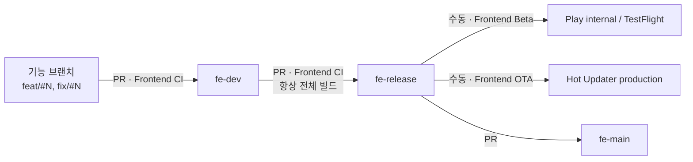
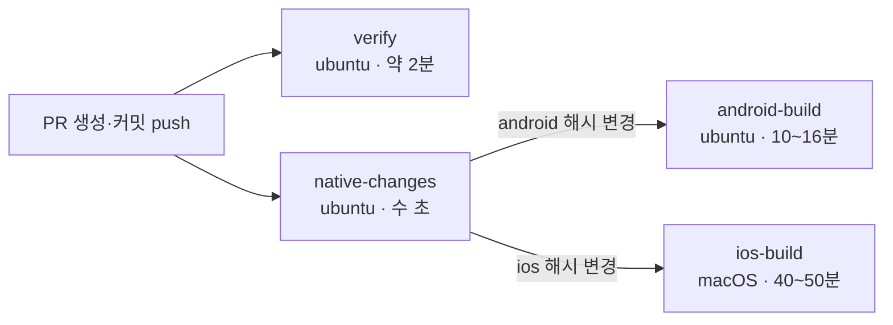
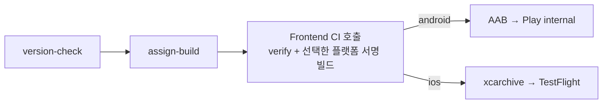

# Frontend CI/CD

프론트엔드는 GitHub Actions 워크플로 3개로 검증하고 배포한다.

| 워크플로 | 실행 조건 | 하는 일 |
| --- | --- | --- |
| [`frontend-ci.yml`](../../.github/workflows/frontend-ci.yml) | `fe-dev`, `fe-release`로 향하는 PR (자동), Beta에서 호출 | 코드 검사, 네이티브 컴파일 확인, beta용 서명 빌드 |
| [`frontend-beta.yml`](../../.github/workflows/frontend-beta.yml) | 수동 실행 (`fe-release`) | 스토어 빌드를 Play internal 또는 TestFlight에 업로드 |
| [`frontend-ota.yml`](../../.github/workflows/frontend-ota.yml) | 수동 실행 (`fe-release`) | JS 번들만 Hot Updater로 production 채널에 배포 |

## 브랜치 흐름

1. 기능 브랜치에서 `fe-dev`로 PR을 보내면 Frontend CI가 돈다.
2. QA할 시점에 `fe-dev`에서 `fe-release`로 PR을 보낸다. 이 PR에서는 네이티브 변경 여부와 관계없이 iOS와 Android를 모두 빌드한다.
3. `fe-release`의 HEAD에서 네이티브가 바뀌었으면 Frontend Beta로 스토어에 올리고, JS만 바뀌었으면 Frontend OTA로 배포한다.

## Frontend CI (PR)

모든 job은 병렬로 실행된다. 같은 PR에 새 커밋을 올리면 진행 중이던 이전 실행은 취소된다.

### verify

| 단계 | 명령 |
| --- | --- |
| 의존성 설치 | `npm ci` |
| Lint | `npm run lint` |
| 타입 검사 | `npm run typecheck` |
| 테스트 | `npm run test:ci` |
| JS 번들 생성 | `react-native bundle --dev false` (iOS, Android) |
| fingerprint 검사 | `npx hot-updater fingerprint create` 결과가 커밋된 `fingerprint.json`과 같은지 확인 |

fingerprint 검사가 실패하면 네이티브를 바꾸고 `fingerprint.json`을 갱신하지 않은 것이다. `Frontend`에서 `npx hot-updater fingerprint create`를 실행하고 결과를 커밋한다.

JS 번들 생성은 네이티브 빌드를 건너뛰는 PR에서도 Release 빌드가 하던 Metro 번들 확인을 대신한다.

### native-changes: 네이티브 빌드 여부 결정

PR이 바꾼 플랫폼만 네이티브 빌드를 한다. base 브랜치와 PR의 `fingerprint.json`에서 플랫폼별 `hash`를 비교한다.

| 조건 | android-build | ios-build |
| --- | --- | --- |
| `fe-release`로 가는 PR | 실행 | 실행 |
| `fingerprint.json`의 android 해시 변경 | 실행 | - |
| `fingerprint.json`의 ios 해시 변경 | - | 실행 |
| `.github/workflows/frontend-ci.yml`, `Frontend/.nvmrc` 변경 | 실행 | 실행 |
| `Frontend/Gemfile`, `Gemfile.lock`, `ios/Podfile.lock` 변경 | - | 실행 |
| 그 외 (JS만 변경) | 건너뜀 | 건너뜀 |

해시가 실제 네이티브 코드와 일치하는지는 verify의 fingerprint 검사가 보장한다. 건너뛴 job은 GitHub에서 Skipped로 표시되며, 필수 체크로 지정돼 있어도 통과로 처리된다.

### android-build

Release APK가 컴파일되는지 확인한다. 스토어 서명 없이 저장소의 개발용 키(`debug.keystore`)로 서명하고, 빌드 설정은 임시 값(`ci-placeholder`)을 쓴다.

- NDK를 먼저 설치하고, Gradle 배포 파일 다운로드를 재시도한다.
- `./gradlew :app:assembleRelease -PreactNativeArchitectures=arm64-v8a`로 arm64 하나만 빌드한다. 배포용 AAB는 모든 ABI를 빌드한다.
- 외부 저장소 응답 오류(429, 5xx, 타임아웃)일 때만 최대 5번 재시도하고, 컴파일 오류는 바로 실패한다.

### ios-build

iOS 시뮬레이터용 Release 앱이 컴파일되는지 확인한다. 코드 서명은 하지 않는다.

- Ruby 설정(최대 3번 시도) → `npm ci` → `pod install`(네트워크 오류 시 최대 5번) 순서로 준비한다.
- `pod install` 후 iOS fingerprint가 커밋된 값과 같은지 다시 확인한다. 다르면 그 빌드는 OTA 번들을 받지 못하므로 빌드 전에 멈춘다.
- `xcodebuild -configuration Release -sdk iphonesimulator`로 빌드한다.

`ios/Podfile`이 dSYM 생성을 위해 Hermes와 RN 코어를 소스에서 빌드하도록 고정하고 있어(`RCT_BUILD_HERMES_FROM_SOURCE=true`, `RCT_USE_PREBUILT_RNCORE=0`), 빌드 시간 대부분이 여기서 나온다.

## Frontend Beta (수동)

**Actions → Frontend Beta → Run workflow**에서 브랜치 `fe-release`, 플랫폼(`android` 또는 `ios`), 앱 버전(예: `1.1.0`)을 지정한다.

| job | 하는 일 |
| --- | --- |
| `version-check` | 실행 브랜치가 원격 `fe-release` HEAD와 같은지, 버전 형식이 맞는지 확인 |
| `assign-build` | 빌드 번호 = 플랫폼별 오프셋 + `GITHUB_RUN_NUMBER` |
| `ci` | Frontend CI를 `beta_platform`과 함께 호출. `verify`와 `android-beta-build` 또는 `ios-beta-build`만 실행 |
| `android-beta` | CI가 만든 AAB를 Play internal 트랙에 업로드 |
| `ios-beta` | CI가 만든 아카이브를 export해 TestFlight에 업로드 |

beta 빌드는 `fe-beta` Environment Secrets로 설정 파일을 만들어 실제 서명과 운영 설정으로 빌드한다. 실행은 한 번에 하나씩만 진행된다. 최근 소요 시간은 Android 약 16분, iOS 35~45분이다.

빌드 번호 정책, 필요한 Secrets, 스토어 선행 설정은 [BETA_DEPLOYMENT.md](./BETA_DEPLOYMENT.md)에 정리돼 있다.

## Frontend OTA (수동)

**Actions → Frontend OTA → Run workflow**에서 브랜치 `fe-release`, 플랫폼(`all`, `ios`, `android`), 배포 메시지를 지정한다. `disabled`를 켜면 업로드만 하고 기기에는 전달하지 않는다.

1. `release-check`: 실행 브랜치가 `fe-release` HEAD인지 확인하고, `all`이면 두 플랫폼으로 나눈다.
2. `deploy`: 플랫폼마다 병렬로 `npm ci` → fingerprint 검사 → `npx hot-updater deploy -c production`을 실행한다. 번들은 서명해 Cloudflare R2/D1에 올리고, 소스맵은 Sentry에 올린다.

한 플랫폼이 실패해도 다른 플랫폼은 계속 배포한다. 실패한 쪽은 **Re-run failed jobs**로 다시 실행한다. 실행 요약에 배포된 Bundle ID가 남는다.

OTA는 fingerprint가 같은 앱에만 전달된다. 아직 출시하지 않은 네이티브 변경이 `fe-release`에 들어 있으면 어떤 앱도 받지 못하므로, 그때는 Frontend Beta로 스토어에 먼저 출시한다.

## 소요 시간

| 상황 | 소요 시간 |
| --- | --- |
| JS만 바꾼 PR | 약 2~3분 (verify만 실행, 예상치) |
| 네이티브를 바꾼 PR, `fe-release` PR | 45~55분 (iOS 빌드가 결정) |
| Beta Android | 약 16분 |
| Beta iOS | 35~45분 |

2026년 11월 기준 최근 실행 기록으로 잰 값이다. 네이티브 변경 감지를 넣기 전에는 모든 PR이 45~55분 걸렸다. 최근 `fe-dev` 머지 30건 중 fingerprint가 바뀐 PR은 3건이었다.

## 문제가 생겼을 때

| 증상 | 원인과 조치 |
| --- | --- |
| verify의 `Check fingerprint` 실패 | 네이티브 변경 후 `fingerprint.json`을 갱신하지 않았다. `npx hot-updater fingerprint create` 후 커밋한다. |
| `Check iOS fingerprint after pod install` 실패 | `pod install`이 `ios/` 파일을 바꿨다. 로그의 `git status` 목록을 확인하고 로컬에서 `pod install` 결과를 커밋한다. |
| Android에서 NDK, Gradle 다운로드 실패 | 외부 저장소 일시 장애다. 재시도 후에도 실패하면 job을 다시 실행한다. |
| JS만 바꿨는데 네이티브 빌드가 돈다 | `native-changes` 로그의 `base=… head=… build=…` 줄에서 이유를 확인한다. |

## 개선 후보

- `Podfile`에서 PR CI만 prebuilt Hermes/RN 코어를 쓰도록 환경변수로 덮어쓸 수 있게 한다. iOS fingerprint가 바뀌므로 다음 네이티브 출시 때 함께 반영한다.
- 그래도 네이티브 PR이 부담되면 `fe-dev` PR에서는 라벨을 붙였을 때만 iOS를 빌드하는 방식을 검토한다.
