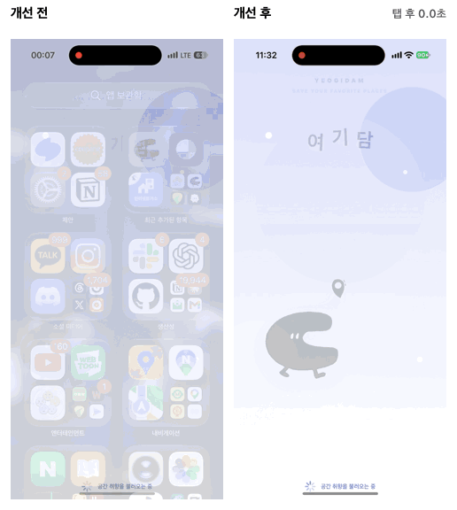
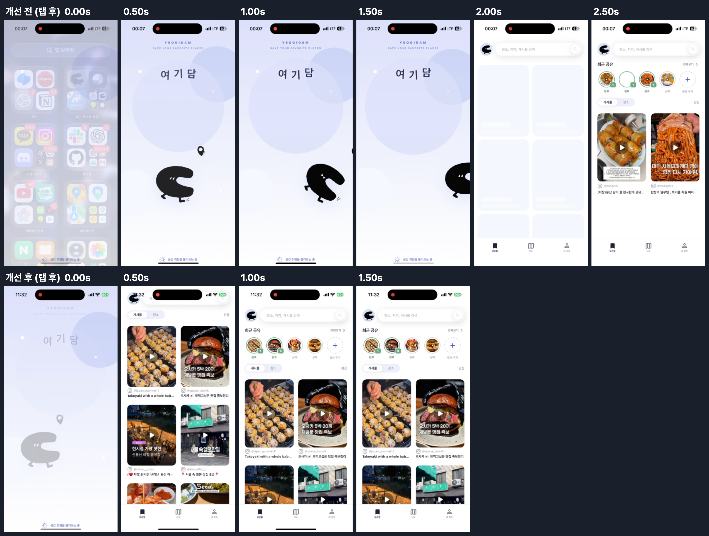

# 여기담 로딩 성능 개선 리포트

- 대상: 여기담 iOS 앱 (React Native 0.86, Hermes)
- 측정 범위: **iOS만** 측정한다. 팀에 측정용 Android 실기기가 없어 같은 조건으로 전후를 비교할 수 없기 때문이다. 개선 대부분(스플래시 대기 구조, API 직렬, 번들·이미지)은 JS 공통 코드라 Android에도 그대로 적용된다.
- 기준 커밋: `3637d258` (번들·에셋 수치는 이 시점에 측정)
- 작업 브랜치: `perf/loading-performance` (개선 하나당 커밋 하나)

> 측정하지 못한 값과 그 대신 쓴 방법은 [3-4. 측정 한계](#3-4-측정-한계)에 모았다.

---

## 0. 요약

| 항목 | 내용 |
|---|---|
| 핵심 경험 | ① 앱을 켜서 저장한 장소를 확인하기 ② 처음 설치한 사용자가 온보딩 첫 화면을 보기 |
| 관리 지표 | Cold start TTID(FCP에 대응), 핵심 화면 TTFD(LCP에 대응, 스켈레톤 해제·게시물 그리드), 첫 화면 API 대기(TTFB에 대응), JS 번들·에셋 크기 |
| 찾은 병목 | ① 스플래시가 **최소 2초 고정**이고, 업데이트 정책 API(최대 5초)까지 기다림 ② 저장 장소 API는 스플래시가 **끝난 뒤에야** 요청을 시작함(직렬) ③ 스플래시 GIF가 **4096×1714, 16프레임**인데 화면에는 560pt로 표시됨 ④ JS 번들(3.5MB)에서 소스맵으로 출처가 잡히는 3.1MB 중 **Sentry가 1.1MB(35%)** ⑤ 첫 화면·가이드 이미지가 2~4MB |
| 개선 방향 | 기다리는 구조 바꾸기 → 무거운 이미지 줄이기 → 쓰지 않는 SDK 코드 빼기 → 마지막 데이터 캐시 |
| 결과 | 스켈레톤 해제(p75) **Wi-Fi 2,312ms → 569ms (−75%)**, **3G 4,495ms → 3,109ms (−31%)**. 가장 큰 효과는 개선 1(스플래시 대기 구조)이었다. 3G에서 남은 대기는 개선 3(캐시)이 다시 켰을 때 게시물 그리드 기준 **6.7초 → 0.6초**로 줄였다 |

### 웹 지표와 앱 지표의 대응

미션은 웹 기준이지만 여기담은 React Native 앱이다. 같은 문제("첫 화면이 늦게 뜬다")를 앱에서는 다음과 같이 잰다.

| 웹 | 앱 | 여기담에서의 의미 |
|---|---|---|
| TTFB | 첫 화면 API 응답 시간 | 저장 장소 목록 API, 업데이트 정책 API |
| FCP | **TTID** (Time To Initial Display) | 아이콘을 누르고 스플래시가 끝나 첫 화면이 그려지기까지 |
| LCP | **TTFD** (Time To Full Display) | 저장 장소 목록이 실제 데이터로 채워지기까지 |
| (웹에는 없음) | **App Start** (cold / warm) | 프로세스 생성 → 네이티브 초기화 → JS 번들 로드까지 |
| 번들 크기 | JS 번들 + 에셋 크기 | 앱 시작 때 해석할 JS 양. OTA 업데이트 다운로드 크기에도 그대로 영향 |

| 웹 도구 | 앱에서 쓴 도구 |
|---|---|
| Lighthouse | Sentry Performance (`app.startup` 트랜잭션) + 실기기 자동 반복 측정 |
| Performance 탭 | Xcode Instruments(App Launch, Allocations), React Native DevTools Performance |
| Network 탭 | TTFD에서 스플래시 시간을 빼 API 대기 추정 (한계: 요청별 span은 따로 남기지 않음) |
| Coverage | Metro `inlineRequires` 확인, Hermes 프로파일 |
| 번들 분석기 | `react-native bundle` + 소스맵으로 패키지별 크기 계산 |

---

## 1. 성능 관리 대상

### 1-1. 핵심 사용자 경험

여기담은 SNS에서 본 장소를 저장하고 다시 찾는 앱이다. 사용자가 앱을 여는 순간은 대부분 "저장해 둔 그 장소가 어디였지?"를 확인하려는 때다. 그래서 **앱을 열고 저장한 장소가 보이기까지**를 가장 중요한 경험으로 정했다.

| 우선순위 | 경험 | 시작 | 끝 | 근거 |
|---|---|---|---|---|
| 1 | 저장 장소 확인 (로그인 사용자) | 아이콘 탭 | 저장 장소 목록이 데이터로 채워짐 | 로그인하면 항상 `saved` 탭으로 시작 (`App.tsx` `setFlowState`) · 앱 실행의 **74.5%**가 로그인 상태 (아래 표) |
| 2 | 첫 진입 (신규·게스트) | 아이콘 탭 | 온보딩 첫 화면 이미지가 보임 | 첫인상에서 이탈하면 가입까지 오지 않음 · 온보딩 첫 장에서 **11%**가 이탈 (아래 표) |
| 3 | 공유 → 장소 추출 결과 | 공유 시트에서 공유 | 추출된 장소가 보임 | 서비스의 핵심 가치. 다만 서버 추출 시간이 대부분이라 이번 범위에서는 **로딩 성능이 아닌 별도 과제**로 분리 |

**PostHog 근거** (최근 30일, 2026-10-16 ~ 11-12, 앱스토어 버전 2.x만. 측정용 로컬 빌드 1.x는 제외)

| `app_opened` | 실행 수 | 비율 | 사용자 수 | 1인당 실행 |
|---|---|---|---|---|
| 로그인 | 675 | **74.5%** | 71 | 9.5회 |
| 게스트 | 231 | 25.5% | 178 | 1.3회 |

| 온보딩 퍼널 (`step_viewed`, `flow_name = onboarding`) | 사용자 수 | 첫 장 대비 |
|---|---|---|
| 1장 | 56 | 100% |
| 2장 | 50 | 89% |
| 로그인 시작 | 45 | 80% |
| 로그인 완료 | 44 | 79% |

- 앱이 켜지는 순간의 3/4은 로그인 사용자가 저장한 장소를 보러 오는 경우다. 로그인 사용자는 한 달에 1인당 9.5번 앱을 연다. 그래서 **저장 장소 확인(1순위)**의 시작 시간이 가장 많이 반복되는 대기다
- 게스트는 사람 수는 많지만 대부분 한두 번 연다. 온보딩 첫 장에서 11%가 떠나므로, 첫 진입(2순위)은 첫인상 관리 대상으로 두었다
- 조회: PostHog HogQL (`events` 테이블, `properties.$app_version`이 `1.`로 시작하는 측정용 빌드 제외)

### 1-2. 지금 앱이 켜지는 과정

코드(`index.js`, `App.tsx`)를 따라가 보면 다음과 같다.

```
아이콘 탭
 └─ 네이티브 초기화 + LaunchScreen
     └─ JS 번들 로드(Hermes) → Sentry/PostHog/HotUpdater 초기화
         └─ JS 스플래시 (SplashScreen, 4096×1714 GIF)
             ├─ 토큰 읽기 (Keychain)
             ├─ 업데이트 정책 API  ← 타임아웃 5초
             └─ 최소 2초 타이머   ← SPLASH_MIN_DURATION_MS
                 (셋 다 끝나야 스플래시 종료: Promise.allSettled)
                 └─ 저장 장소 화면 마운트
                     └─ 저장 장소 API 요청 시작  ← 여기서야 시작
                         └─ 목록 표시 (TTFD)
```

즉, 네트워크가 아무리 빨라도 **스플래시가 최소 2초**이고, 그 뒤에 저장 장소 API를 **처음부터 다시 기다린다**. 웹에서 말하는 요청 워터폴과 같은 구조다.

---

## 2. 성능 예산

### 2-1. 기준으로 삼은 값

| 참고 기준 | 값 |
|---|---|
| Apple 권장 (WWDC "Optimizing App Launch") | 첫 프레임까지 400ms 이내 |
| Android vitals 과도한 시작 시간 (참고) | cold 5초 이상 · warm 2초 이상 · hot 1.5초 이상 |
| Web Vitals LCP "좋음" | 2.5초 이하 (TTFD 목표의 참고값) |
| 우리 기준선 | 로그인 TTFD p75 Wi-Fi 2,312ms · 3G 4,495ms, 게스트 첫 화면 p75 2,072ms (3-3) |

### 2-2. 예산

측정 기기: iPhone 15 (iOS 27.0.1) / 네트워크: Wi-Fi·3G(Network Link Conditioner) 조건

| 지표 | 대상 | 예산 (p75) | 기준선 | 목표 근거 |
|---|---|---|---|---|
| Cold start TTID | 스플래시 → 첫 화면 | **2.0초** 이하 | 게스트 2,072ms · 로그인은 2초 이상(구조상) | 지금은 구조상 2초 미만이 불가능함(최소 2초 고정) |
| 저장 장소 TTFD | 목록이 데이터로 채워짐 | **2.5초** 이하 | Wi-Fi 2,312ms · 3G 4,495ms | LCP "좋음" 기준과 맞춤 |
| 저장 장소 API | **서버 처리 시간** | **500ms** 이하 | 따로 재지 않음. 앱에서 본 대기는 Wi-Fi 약 230~310ms · 3G 약 2.5초 (추정 ※) | 네트워크 조건과 관계없는 서버 몫의 예산. 앱에서 본 대기에는 네트워크 시간이 섞여 있어 이 예산의 판정에 쓰지 않는다 (3-4) |
| JS 번들 (minified) | `main.jsbundle` | **2.8MB** 이하 | 3.5MB | 쓰지 않는 SDK 코드 제거 여유분 |
| 첫 화면 이미지 1장 | 스플래시·온보딩 | **300KB** 이하, 표시 크기의 3배 해상도 이하 | 238KB / 1.9MB | 디코딩 메모리·시간 |
| OTA 업데이트 패키지 | 번들 + 에셋 | 정하지 않음 | 약 16MB (추정 ※※) | 실제 OTA 패키지는 배포해야 알 수 있어 이번 범위에서 뺐다 |

※ 앱에서 잰 TTFD에서 스플래시 최소 시간(2초)을 뺀 값이다. 네트워크 왕복과 화면 그리기가 섞여 있어 서버 처리 시간보다 크다
※※ 앱 안 Hermes 바이트코드 4.1MB + iOS 에셋 12MB

---

## 3. 측정

### 3-1. 측정 환경

| 항목 | 값 |
|---|---|
| 빌드 | **release 빌드** (debug는 JS를 Metro에서 받아서 수치가 의미 없음) |
| 기기 | iPhone 15 (iOS 27.0.1). 개선 전부터 끝까지 같은 기기로만 잰다. 비교적 최신 기기라 절대값은 실사용자 평균보다 빠를 수 있으므로 전후 차이를 중심으로 보고, 절대값은 배포 후 Sentry 실사용자 p75로 보완한다 |
| 네트워크 | Wi-Fi / Network Link Conditioner "3G" (설정 → 개발자) |
| 반복 | 커밋·시나리오마다 10회. Mac에서 `xcrun devicectl`로 앱을 종료 → 3초 대기 → 실행 → 12초(3G는 20초) 대기를 자동 반복했다. 설치 직후 첫 실행은 캐시 영향으로 제외. 중앙값(p50)·p75 기록 |
| 자료 | 실행 시각 `docs/perf-data/startup-runs-2026-11-12.csv`, 측정 스크립트 `measure.sh`, 집계 스크립트 `analyze.py`, 집계 결과 `startup-summary-2026-11-12.txt` |
| 실사용자 | 이번 리포트는 실기기 실험실 측정만 담았다. 개선 0을 배포하면 Sentry에 실사용자 값이 쌓인다 (7장 남은 과제) |

### 3-2. 측정 방법

- **첫 프레임까지(네이티브 + 번들 로드)**: Xcode Instruments **App Launch** 템플릿
- **TTFD**: Sentry `app.startup` 트랜잭션 길이 (개선 0). JS 실행 시작 → 저장 장소 응답으로 스켈레톤이 걷히는 시점이다
- **게시물 그리드**: Sentry `app.startup.posts` 트랜잭션 길이 (개선 3부터). 보관함 기본 탭에서 사용자가 실제로 보는 목록이 채워지는 시점이다
- **TTID**: `app.startup`의 `time_to_initial_display` measurement. 이번 내보내기에서는 빠져, TTFD를 상한으로 썼다 (한계)
- **네이티브 구간**: Sentry `App Start` 트랜잭션 (아이콘 탭 → 루트 컴포넌트 마운트). 개선과 관계없는 구간이라 따로 적는다
- **API 응답**: 별도 HTTP span 없이 TTFD에서 스플래시 시간을 빼 추정했다 (한계)
- **번들 구성**: production 번들 + 소스맵으로 패키지별 바이트 계산

### 3-3. 기준선 결과

#### 시작 시간

기준선 커밋 `ee3d2fc4`, 로그인 상태, 10회씩. 값은 `app.startup` 트랜잭션 길이(JS 실행 시작 → 저장 장소 목록 표시 = TTFD)다.

| 시나리오 | TTFD p50 | TTFD p75 |
|---|---|---|
| 로그인 · Wi-Fi | **2,230ms** | **2,312ms** |
| 로그인 · 3G | **4,479ms** | **4,495ms** |
| 게스트 · Wi-Fi (첫 화면까지) | 2,062ms | 2,072ms |

- 게스트 값은 같은 날 수동으로 잰 11회다. 네트워크 없이 끝나는 온보딩 경로라 TTID에서 끝난다
- **한계**: TTID는 Sentry 내보내기에 measurement 열이 빠져 로그인 실행에서 따로 구하지 못했다. TTID는 TTFD보다 클 수 없어서, 예산 판단에는 TTFD를 상한으로 썼다
- 같은 날 수동으로 잰 "로그인 · Wi-Fi" 10회(p50 4,496ms)는 자동 측정 기준선과 크게 달라 네트워크 조건을 통제하지 못한 것으로 보고 제외했다

**네이티브 구간** (`App Start`, 중앙값): UIKit 초기화 → JS 실행 시작 **45ms**, 루트 컴포넌트 전 번들 실행 **51ms**, 합계 약 **125ms**. 위 값에 더하면 아이콘 탭부터의 시간이 된다

**읽을 수 있는 것**
- 게스트 실행이 **2,056~2,072ms에 몰려 있다**. 스플래시 최소 2초에 약 60ms만 더해진 값이다. 준비는 이미 끝났는데 2초 고정 타이머가 화면을 붙잡고 있다 (병목 1)
- 로그인 · Wi-Fi는 2초 뒤에 약 230~310ms가 더 걸린다. 저장 장소 API가 스플래시가 끝난 뒤에야 시작되기 때문이다 (병목 2)
- 3G에서는 2초 뒤에 약 2.5초가 더 걸린다. 느린 네트워크에서는 API 대기가 가장 큰 덩어리다
- 네이티브 구간 125ms는 전체의 5% 남짓이다. 느린 원인은 앱 프로세스 시작이 아니라 JS가 시작된 뒤 기다리는 구조에 있다

**Instruments App Launch** (아이콘 탭 → 첫 프레임, 각 1회, `docs/perf-data/app-launch-lifecycle-2026-11-12.txt`)

| 단계 | 기준선 `ee3d2fc4` | 최종 `2644a433` |
|---|---|---|
| 프로세스 생성 | 379.3ms | 354.0ms |
| 시스템 프레임워크 초기화 | 36.6ms | 30.6ms |
| 정적 런타임 초기화 | 16.9ms | 16.8ms |
| UIKit 초기화 | 24.9ms | 26.0ms |
| `didFinishLaunchingWithOptions` | 21.9ms | 22.1ms |
| 첫 프레임 그리기 | 2.0ms | 2.1ms |
| **첫 프레임까지 합계** | **485.6ms** | **455.8ms** |

- 1회씩만 잰 값이라 30ms 차이는 오차 범위로 본다. 이번 개선은 모두 JS 쪽이라 네이티브 실행 구간은 바뀌지 않는 게 맞다
- 첫 프레임까지 약 0.46~0.49초로 Apple 권장(400ms)보다 조금 길다. 대부분이 프로세스 생성(약 0.35초)이고, Instruments를 붙여 기록하면 이 구간이 늘어나는 경향이 있다 (Sentry로 잰 UIKit → JS 시작은 45ms)
- 원본 기록: `Frontend/build/perf-traces/app-launch-*.trace` (용량이 커서 git에는 넣지 않음, Instruments로 열어 볼 수 있다). 앞서 수동으로 찍은 기준선 캡처는 `docs/perf-data/instruments-app-launch-baseline.webp`
> **한계**: Sentry App Start waterfall은 `extendAppStart`가 적용되지 않아 얻지 못했다 (개선 0 참고)

#### JS 번들 구성

`react-native bundle --platform ios --dev false --minify true`로 만든 번들을 소스맵으로 쪼갰다.

| 항목 | 크기 |
|---|---|
| `main.jsbundle` (minified) | **3.5MB** (gzip 922KB) |
| 함께 묶인 에셋 | **12MB** (24개 파일) |

| 분류 | 크기 | 비율 |
|---|---|---|
| **Sentry** (`@sentry/*` 9개 패키지) | **1,108KB** | **35%** |
| React Native · React 코어 | 752KB | 24% |
| 우리 코드 (`src`, `App.tsx`) | 477KB | 15% |
| PostHog | 410KB | 13% |
| 기타 라이브러리 | 430KB | 13% |

Sentry 내부를 더 쪼개면 다음과 같다.

| 패키지 | 크기 | 우리가 쓰는가 |
|---|---|---|
| `@sentry/conventions` | 290KB | 사용 (`@sentry/core`가 직접 의존하는 속성 이름 상수 모음) |
| `@sentry/react-native` | 268KB | 사용 |
| `@sentry/core` | 197KB | 사용 |
| `@sentry/replay` | **134KB** | **안 씀** (웹용 세션 리플레이) |
| `@sentry/browser` | 80KB | 간접 의존 |
| `@sentry/feedback` | **49KB** | **안 씀** (웹용 피드백 위젯) |

> 번들 구성은 소스맵으로 직접 집계했다. 같은 결과를 트리맵으로 보는 명령은 부록 A에 적었다.

#### 큰 에셋

| 파일 | 크기 | 해상도 | 어디서 | 첫 화면인가 |
|---|---|---|---|---|
| `guide/ios-share.gif` | 4.4MB | 900×1500 | 앱 가이드 | 아니오 |
| `guide/ios-favorite.gif` | 2.8MB | | 앱 가이드 | 아니오 |
| `onboarding/guest-map-centered.png` | **1.9MB** | 1047×1502 | 온보딩 | **예 (게스트)** |
| `illustrations/moving-emotion.gif` | 238KB | **4096×1714, 16프레임** | 스플래시 | **예 (모두)** |

Android 가이드용 GIF(`android-share.gif` 6MB 등)는 iOS 번들에서는 빠지고 Android 번들에만 들어가므로 이번 측정 범위에서 제외했다.

### 3-4. 측정 한계

정확히 재지 못한 값과 그 대신 쓴 방법이다. 어느 것도 개선 순서나 결론을 바꾸지는 않는다.

| 재지 못한 것 | 이유 | 대신 쓴 방법 | 결론에 미치는 영향 |
|---|---|---|---|
| TTID 정확한 값 | Sentry 내보내기에 `time_to_initial_display` measurement 열이 빠졌다 | TTID는 TTFD보다 클 수 없으므로 TTFD를 상한으로 썼다 | 상한으로도 예산(2.0초)을 넉넉히 만족해 판단이 바뀌지 않는다 |
| 저장 장소 API 서버 처리 시간 | 요청별 HTTP span을 남기지 않았고, 백엔드 로그는 이번 범위에서 보지 않았다 | TTFD에서 스플래시 시간을 빼 추정했다 (네트워크 왕복·그리기 포함) | 서버는 바꾸지 않았으므로 전후 비교에는 영향이 없다 |
| 스플래시 대기 waterfall | `extendAppStart`(실험 API)가 실기기에서 적용되지 않아 하위 span이 기록되지 않았다 | 모든 커밋을 `app.startup` 트랜잭션 하나로 비교했다 (개선 0) | 구간별 분해 대신 커밋별 차이로 원인을 나눴다 |
| 실사용자 분포 | 측정 코드를 아직 배포하지 않았다 | iPhone 15 한 대에서 조건을 고정해 10회씩 반복했다 | 절대값은 실사용자보다 빠를 수 있어 전후 차이를 중심으로 본다 |
| Android | 측정용 실기기가 없다 | iOS만 쟀다. 개선은 대부분 JS 공통 코드다 | Android 효과는 배포 후 확인한다 |
| OTA 패키지 크기 | 실제 배포를 해야 알 수 있다 | 번들·에셋 크기로 추정했다 | 예산을 정하지 않았다 |
| Instruments App Launch | 기기 1대에서 각 1회만 기록했다 | 네이티브 구간은 Sentry `App Start` 중앙값(약 125ms)과 함께 봤다 | 이번 개선은 JS 쪽이라 이 구간은 비교 대상이 아니다 |
| 실행 녹화 | 개선 전은 LTE, 개선 후는 Wi-Fi에서 녹화됐다 | 녹화는 체감 자료로만 쓰고 수치는 Sentry 반복 측정을 기준으로 했다 | 수치 결론에는 쓰지 않았다 |

---

## 4. 병목 분석

### 병목 1. 스플래시가 기다리는 구조 (가장 큼)

- **현상**: `SPLASH_MIN_DURATION_MS = 2000`으로 스플래시가 최소 2초 동안 떠 있고, `Promise.allSettled([토큰 읽기, 업데이트 정책 API, 2초 타이머])`가 모두 끝나야 화면이 넘어간다.
- **영향**:
  - 네트워크가 빨라도 TTID가 2초보다 짧아질 수 없다.
  - 업데이트 정책 API가 느리면 최대 5초(타임아웃)까지 스플래시에 묶인다. 이 API는 대부분 "업데이트 없음"을 돌려주는데, 그 응답 때문에 모든 사용자가 기다리는 셈이다.
- **웹 대응**: 렌더링을 막는 리소스(render-blocking resource)
- **확인한 자료**: 게스트 첫 화면이 2,056~2,072ms에 몰려 있다 (3-3). 업데이트 정책 API 시간만 따로 재는 span은 기록되지 않았다 (한계, 개선 0)

### 병목 2. 저장 장소 API가 스플래시 뒤에 시작함

- **현상**: 저장 장소 목록은 `SavedPlacesScreen`이 마운트된 뒤 `useEffect`에서 요청한다. 스플래시 2초 동안 네트워크는 쉬고 있다.
- **영향**: TTFD ≈ 스플래시 시간 + 저장 장소 API 시간. 두 시간이 겹치지 않고 더해진다.
- **웹 대응**: 요청 워터폴, preload 부재
- **확인한 자료**: 로그인 TTFD가 Wi-Fi에서 2초 + 230~310ms, 3G에서 2초 + 약 2.5초다 (3-3)

### 병목 3. 스플래시 GIF의 해상도

- **현상**: `moving-emotion.gif`는 4096×1714, 16프레임인데 화면에는 `560×560`(contain)으로 표시된다. 3x 기기에서도 가로 1680px이면 충분하다.
- **영향**: 파일은 238KB로 작지만 **디코딩 후 크기는 프레임당 약 28MB**(4096×1714×4바이트)다. 앱이 시작되는 가장 바쁜 순간에 메인 스레드와 메모리를 쓴다. 구형 기기에서 스플래시 애니메이션이 끊기는 원인이 될 수 있다.
- **웹 대응**: 표시 크기보다 큰 이미지(Lighthouse "Properly size images")
- **확인한 자료**: Instruments Allocations 기준선 (`docs/perf-data/instruments-allocations-baseline.webp`). 약 8초 녹화 동안 **Anonymous VM 누적 할당이 561.88 MiB**로, 풀린 GIF 프레임(16장 × 약 28MB ≈ 449MB)과 규모가 비슷하다. 개선 4 이후 같은 값이 127.50 MiB로 줄어 원인이 GIF였음을 확인했다 (개선 4)

### 병목 4. 쓰지 않는 SDK 코드가 번들에 들어감

- **현상**: 번들의 35%가 Sentry다. 그중 `@sentry/replay`(134KB)·`@sentry/feedback`(49KB)는 웹용 기능이라 앱에서 쓰지 않는다. Metro는 tree shaking을 하지 않아서 import 경로에 걸리면 그대로 들어간다.
- **영향**: Hermes가 시작 때 읽어야 하는 바이트코드가 늘어난다. OTA 업데이트 패키지도 그만큼 커진다.
- **웹 대응**: Coverage에서 잡히는 안 쓰는 JS
- **참고**: `inlineRequires`는 `@react-native/metro-config` 기본값으로 이미 켜져 있다. 그래서 화면 단위 코드 스플리팅(웹의 route splitting)은 사실상 이미 적용된 상태이고, 추가로 얻을 게 적다고 판단했다.

### 병목 5. 게스트 첫 화면 이미지

- **현상**: 온보딩 첫 화면의 `guest-map-centered.png`가 1.9MB PNG다. 사진에 가까운 지도 이미지라 PNG가 맞지 않는 형식이다.
- **영향**: 신규 사용자 첫인상 화면의 이미지 디코딩 지연. 앱 용량과 OTA 패키지 크기 증가.
- **웹 대응**: LCP 이미지 최적화

### 우선순위

| 병목 | 영향 지표 | 효과 예상 | 난이도 | 순서 |
|---|---|---|---|---|
| 1. 스플래시 대기 구조 | TTID, TTFD | 큼 (최소 2초 제거) | 낮음 | **1** |
| 2. 저장 장소 API 직렬 | TTFD | 큼 | 중간 | **2** |
| 3. 스플래시 GIF | TTID, 메모리 | 중간 (저사양에서 큼) | 낮음 | **3** |
| 4. Sentry 번들 | App Start, OTA 크기 | 작음~중간 | 낮음 | **4** |
| 5. 게스트 이미지·가이드 GIF | 게스트 TTFD, 앱·OTA 크기 | 중간 | 낮음 | **5** |

---

## 5. 개선 과정

각 개선은 **가설 → 조치 → 결과** 순서로 적는다. 결과는 적용 후 같은 기기·네트워크 조건으로 다시 잰 값이다.

개선마다 커밋을 하나씩 쌓았다. 개선 효과를 하나씩 나눠 볼 수 있도록, 커밋마다 release 빌드를 만들어 순서대로 쟀다.

| 순서 | 커밋 | 개선 | 측정한 것 |
|---|---|---|---|
| 0 | `ee3d2fc4` | 개선 0. 측정 코드 | **기준선** (TTFD, 메모리) |
| 1 | `d71ac660` | 개선 1. 스플래시 0.5초 + 업데이트 정책 분리 | TTFD |
| 2 | `110c1a13` | 개선 2. 저장 장소 미리 요청 | TTFD |
| 3 | `8adbba5b` | 개선 5. Sentry 웹 기능 제외 | 번들 크기, TTFD |
| 4 | `4947c0fb` | 개선 4. 스플래시 GIF 축소 | TTFD, 메모리 |
| 5 | `2644a433` | 개선 3. 보관함 캐시 | 캐시 끔 빌드와 나란히 TTFD·게시물 그리드 |

측정은 커밋마다 Release 빌드를 만들어 iPhone에 설치하고 자동으로 반복했다 (3-1, `docs/perf-data/measure.sh`).

### 개선 0. 측정 체계 만들기

- **문제**: `Sentry.init`에 `tracesSampleRate`가 없어서 성능 데이터가 전혀 수집되지 않고 있었다. 여기담은 React Navigation을 쓰지 않고 화면 전환을 직접 관리하기 때문에, Sentry의 자동 TTID/TTFD(`<TimeToFullDisplay>`)도 붙일 수 없었다. 이 기능은 내비게이션 트랜잭션이 있어야 동작한다.
- **조치**: 시작 구간을 직접 표시하는 모듈 `src/lib/performance/startupTrace.ts`를 만들었다.

| Sentry 트랜잭션 | 구간 | 웹 대응 | 하위 span / 값 |
|---|---|---|---|
| `App Start` (standalone, `extendAppStart`로 연장) | 아이콘 탭(네이티브 프로세스 시작) → 스플래시 다음 첫 화면 | **FCP** | `auth_restore`, `update_policy`, `splash_min_duration`, `ui.load.initial_display` |
| `app.startup` | JS 실행 시작 → 저장 장소 목록 표시 | **LCP** | `time_to_initial_display`, `time_to_full_display` measurement, `startup.destination`(saved_places / onboarding / other), `startup.outcome` |

  - `App.tsx`: `tracesSampleRate: 1.0`, `appStartIntegration({ standalone: true })`, 스플래시 대기 작업 3개를 phase span으로 감쌈, 첫 화면 커밋 시 TTID 기록
  - `SavedPlacesScreen.tsx`: 첫 목록 로드 성공 다음 프레임에 TTFD 기록 (실패도 `full_display_failed`로 기록)
  - 측정을 오염시키는 경우는 따로 표시: 시작 중 백그라운드 전환 → `backgrounded`, 30초 안에 목록이 안 뜸 → `timeout`
- **측정할 때 주의**: debug 빌드 수치는 Metro를 거치므로 Sentry에서 `environment`로 release 빌드만 걸러서 본다.
- **측정해 보니 달라진 점**: `App Start`를 첫 화면까지 늘리는 실험 API(`extendAppStart`)가 실기기에서 적용되지 않았다. 25회 중 22회가 기본 끝점(루트 컴포넌트 마운트, 약 125ms)에서 끝났고, 스플래시 대기 span(`auth_restore`, `update_policy`, `splash_min_duration`)도 기록되지 않았다. 측정 코드를 고치면 기준선을 다시 재야 하고 커밋 간 비교가 어긋나므로, 코드는 그대로 두고 **모든 커밋에서 `app.startup`을 기준으로** 비교하기로 했다. 대신 스플래시 대기 waterfall 캡처는 얻지 못했다
- **검증**: 단위 테스트 `__tests__/startupTrace.test.ts` 통과 · 실기기 release 빌드에서 `app.startup` 트랜잭션 140회 이상이 Sentry에 들어온 것을 확인했다
- **결과**: 이후 모든 개선의 비교 기준이 됐다.
- **커밋**: `ee3d2fc4`

### 개선 1. 스플래시가 기다리지 않게 하기

- **가설**: 최소 2초를 없애고 업데이트 정책 확인을 스플래시에서 분리하면, TTID는 "토큰 읽기 시간"까지 줄어든다.
- **조치**:
  - `SPLASH_MIN_DURATION_MS`를 2000ms → **500ms**로 축소. 최소 시간을 아예 없애면 로딩이 빨리 끝날 때 스플래시가 깜빡이고, 등장 애니메이션(720ms)이 중간에 끊긴다. 0.5초는 깜빡임을 막는 최소한의 값으로 정했다
  - 업데이트 정책 API를 스플래시 종료 조건(`Promise.allSettled`)에서 뺐다. 스플래시는 토큰 읽기와 0.5초만 기다린다
  - 정책 응답이 첫 화면 뒤에 오면 필수 업데이트 모달이 화면을 막는다. 응답이 오기 전에는 이벤트 공지·PMF 설문·위치 권한 요청을 미뤄, 업데이트 모달보다 먼저 뜨지 않게 했다
- **달라진 동작**: 필수 업데이트 대상 사용자는 예전에는 스플래시에서 바로 업데이트 모달을 봤지만, 이제는 첫 화면이 잠깐(정책 API 응답 시간만큼) 보인 뒤 모달이 뜬다. 필수 업데이트는 드물고 모달이 화면을 막으므로, 모든 사용자가 매번 기다리는 비용보다 작다고 판단했다
- **검증**: 정책 응답이 오지 않아도 0.5초 뒤 첫 화면이 뜨고, 늦게 온 필수 업데이트가 모달로 막는 테스트 추가
- **결과** (로그인, 10회씩, TTFD):

| | 기준선 `ee3d2fc4` | 개선 1 `d71ac660` | 차이 |
|---|---|---|---|
| Wi-Fi p50 | 2,230ms | **651ms** | −1,579ms (−71%) |
| Wi-Fi p75 | 2,312ms | **691ms** | −1,621ms (−70%) |
| 3G p50 | 4,479ms | **3,237ms** | −1,242ms (−28%) |
| 3G p75 | 4,495ms | **3,242ms** | −1,253ms (−28%) |

  줄어든 시간이 스플래시 단축분(1.5초)과 거의 같다. Wi-Fi에서는 이제 0.5초 스플래시가 TTFD의 대부분이다
- **커밋**: `d71ac660`

### 개선 2. 저장 장소를 스플래시 동안 미리 불러오기

- **가설**: 토큰을 읽자마자 저장 장소 요청을 시작하면, 스플래시 시간과 API 시간이 겹쳐서 TTFD가 줄어든다.
- **조치**: `src/entities/info/savedPlacesPrefetch.ts`
  - 세션 토큰을 확인한 직후 저장 장소 요청을 시작해 둔다(prefetch)
  - 저장 장소 화면은 첫 로드에서 그 요청을 한 번만 꺼내 쓴다. 10초가 지난 응답은 버리고 새로 요청한다
  - 로그아웃·회원 변경 시 미리 받은 응답을 버려, 다른 회원의 목록이 보이지 않게 했다
- **예상**: 개선 1로 스플래시가 0.5초로 줄어서, 겹칠 수 있는 시간도 그만큼 줄었다. 효과는 개선 1보다 작을 것으로 본다
- **검증**: 1회만 꺼내기, 10초 만료, 회원 변경 시 폐기, 실패 전달 단위 테스트 4개
- **결과** (로그인, 10회씩, TTFD):

| | 개선 1 `d71ac660` | 개선 2 `110c1a13` | 차이 |
|---|---|---|---|
| Wi-Fi p50 | 651ms | **566ms** | −85ms (−13%) |
| Wi-Fi p75 | 691ms | **570ms** | −121ms (−18%) |
| 3G p50 | 3,237ms | **3,105ms** | −132ms (−4%) |
| 3G p75 | 3,242ms | **3,115ms** | −127ms (−4%) |

  예상대로 개선 1보다 효과가 작다. 스플래시가 0.5초로 줄어 API와 겹칠 수 있는 시간이 0.5초뿐이기 때문이다. 3G에서는 API가 3초 가까이 걸려 겹치고 남는 대기가 여전히 크다
- **커밋**: `110c1a13`

### 개선 3. 보관함 마지막 응답 캐시 (stale-while-revalidate)

- **가설**: 마지막 목록을 기기에 저장해 두었다가 먼저 보여주면, 다시 켰을 때 화면이 API 시간과 무관해진다. 느린 네트워크에서 효과가 가장 크다.
- **측정 전에 발견한 것**: 보관함의 기본 탭은 장소가 아니라 **게시물**이다. 지금까지 잰 TTFD(`app.startup`)는 장소 응답이 와서 스켈레톤이 걷히는 시점이고, 사용자가 실제로 보는 게시물 그리드는 별도 API(`getSavedMedia`)로 그 뒤에 채워진다. 그래서 캐시를 **장소와 게시물 첫 페이지 둘 다**에 적용하고, 게시물 그리드가 채워지는 시점(`app.startup.posts`)을 새로 기록했다
- **조치**: `src/entities/info/savedLibraryCache.ts`
  - 저장 장소와 게시물 첫 페이지 응답을 회원별 AsyncStorage 키에 저장한다. 7일이 지난 캐시는 쓰지 않는다
  - 앱 시작 때 스플래시 동안 캐시를 읽고, 보관함 첫 마운트에서 캐시로 먼저 그린다. 서버 응답이 오면 바꾼다
  - 캐시로 그린 게시물의 첫 갱신 요청은 "불러오는 중" 문구 없이 조용히 한다
  - 로그아웃하면 기기 캐시를 전부 지우고, 회원이 바뀌면 이전 회원 캐시는 쓰지 않는다
- **측정 방법**: 측정 코드가 같은 상태에서 캐시만 다르게 비교하려고, 같은 커밋을 **캐시를 끈 빌드**(시작 때 읽은 캐시를 버리도록 임시 수정, 커밋하지 않음)와 **캐시를 켠 빌드**로 나눠 같은 시간대에 10회씩 쟀다
- **결과** (로그인, 10회씩, 단위 ms, p50 / p75):

| 지표 | 네트워크 | 캐시 끔 | 캐시 켬 | 차이 (p75) |
|---|---|---|---|---|
| 스켈레톤 해제 (`app.startup`, 기존 TTFD) | Wi-Fi | 576 / 579 | 602 / 606 | +27 (+5%) |
| 게시물 그리드 (`app.startup.posts`) | Wi-Fi | 697 / 733 | **602 / 607** | **−126 (−17%)** |
| 스켈레톤 해제 (`app.startup`, 기존 TTFD) | 3G | 3,327 / 3,366 | **603 / 605** | **−2,761 (−82%)** |
| 게시물 그리드 (`app.startup.posts`) | 3G | 6,735 / 6,758 | **604 / 605** | **−6,153 (−91%)** |
| 최신 장소 응답 도착 (`places_network`) | Wi-Fi | 575 / 578 | 667 / 672 | +94 |
| 최신 장소 응답 도착 (`places_network`) | 3G | 3,325 / 3,365 | 4,416 / 6,659 ※ | +3,294 |

※ 3G 캐시 켬은 10회 중 8회만 20초 안에 응답이 왔다

- **해석**
  - **3G에서 사용자가 보는 게시물 그리드가 6.7초 → 0.6초**로 줄었다. 캐시가 없을 때 3G의 진짜 대기는 스켈레톤 해제(3.3초)가 아니라 게시물 그리드(6.7초)였다. 기존 TTFD 정의가 실제 체감보다 낙관적이었다는 뜻이다
  - Wi-Fi에서는 이미 API가 빨라서 캐시로 얻는 시간이 작다. 스켈레톤 해제는 캐시를 읽고 그리는 비용 때문에 27ms 늦어졌지만, 게시물 그리드는 126ms 빨라졌다
  - **대가**: 캐시로 먼저 그리면 화면의 썸네일 이미지 다운로드가 바로 시작돼 API와 대역폭을 나눈다. 그래서 3G에서는 **최신 데이터가 도착하는 시점이 늦어졌다**(p50 3.3초 → 4.4초). 사용자는 그동안 마지막으로 본 목록을 보게 된다
  - 캐시는 **두 번째 실행부터** 효과가 있다. 설치 직후나 로그아웃 뒤 첫 실행은 캐시 끔 값과 같다
- **주의**: 다른 기기에서 지운 장소가 최신 응답이 올 때까지 보일 수 있다(3G에서 약 4초). 이 지연을 받아들일지는 팀 논의 과제로 남겼다 (7장)
- **검증**: 캐시 모듈 단위 테스트 4개(재실행 시 읽기, 다른 회원 차단, 로그아웃 삭제, 7일 만료), 측정 단위 테스트 3개 추가. 보관함 화면 단위 테스트는 없고 실기기 측정으로 확인했다
- **커밋**: `2644a433`

### 개선 4. 스플래시 GIF 리사이즈

- **가설**: 표시 크기에 맞게 줄이면 디코딩 메모리와 시간이 줄어 저사양 기기 스플래시가 부드러워진다.
- **조치**: 4096×1714 → 1680×703(560pt 표시, 3x 기준). 새 도구를 설치하지 않고 macOS ImageIO로 프레임마다 줄였다. 프레임 16장, 프레임 간격, 투명 설정은 원본과 같다
- **결과**:

| | 전 | 후 |
|---|---|---|
| 해상도 | 4096×1714 | 1680×703 |
| 파일 크기 | 238KB | **55KB** |
| 디코딩 후 프레임당 크기 (계산) | 약 28MB | **약 4.7MB** |
| Anonymous VM 누적 할당 (Total Bytes, 10초 기록) | 563.14 MiB | **127.50 MiB** (−435.64 MiB, **−77%**) |
| 전체 누적 할당 (All Heap & Anonymous VM, Total Bytes) | 927.23 MiB | **481.44 MiB** (−48%) |
| 시작 구간 최고 메모리 (Current Bytes) | **134.44 MiB** 스파이크 (약 4.6초) | 스파이크 없이 약 64 MiB 수준에서 평탄 ※ |
| 기록 끝 시점 상주 메모리 (Persistent) | 64.19 MiB | 64.09 MiB (변화 없음) |

※ 개선 후 그래프에서는 기준선의 134 MiB 스파이크가 보이지 않는다. 캡처한 지점(7.2초)의 값이 63.65 MiB이고, 정확한 최고값은 따로 읽지 않았다

- **해석**: 줄어든 Anonymous VM(약 436 MiB)은 GIF를 풀었을 때 계산한 차이(프레임당 28.1MB → 4.7MB, 16장 기준 약 356 MiB)와 같은 규모다. 스플래시 GIF가 앱 시작 구간 메모리 스파이크의 주원인이었다는 것을 확인했다. 시작이 끝난 뒤의 상주 메모리는 그대로라, 이 개선은 **시작하는 동안의 순간 메모리 부담**을 줄인 것이다. iPhone 15에서는 시작 시간 차이로 나타나지 않았지만, 메모리가 작은 기기에서는 시작 중 메모리 경고나 프레임 끊김을 줄여 줄 것으로 본다
- **자료**: `docs/perf-data/allocations-ee3d2fc4-*.{webp,png}`, `allocations-4947c0fb-*.webp`

- **측정 방법**: 같은 방법(설치 → 한 번 실행 후 종료 → Instruments Allocations로 10초 기록)으로 기준선 `ee3d2fc4`와 개선 후 `4947c0fb`를 기록했다. 원본은 `build/perf-traces/allocations-*.trace`
- **커밋**: `4947c0fb`

### 개선 5. 쓰지 않는 Sentry 웹 기능 제외

- **가설**: 웹 전용 리플레이·피드백을 번들에서 빼면 번들이 약 180KB 줄어든다.
- **조치**: `metro.config.js`의 `withSentryConfig`에 `includeWebReplay: false`, `includeWebFeedback: false` 옵션 지정. `@sentry/conventions`(290KB)는 `@sentry/core`가 직접 쓰는 패키지라 이번에는 남겼다
- **결과**: 같은 커밋에서 옵션만 바꿔 iOS 번들을 두 번 만들어 비교했다

| | 전 | 후 | 차이 |
|---|---|---|---|
| `main.jsbundle` | 3,669,984B | **3,466,232B** | −199KB (−5.6%) |
| gzip | 945,362B | **879,218B** | −65KB |
| Sentry 비중 | 1,108KB | **910KB** | −198KB |
| 앱 안 Hermes 바이트코드 (`main.jsbundle`) | 4,149,756B | **3,880,252B** | −263KB (−6.5%) |
| 로그인 Wi-Fi TTFD p50 / p75 | 566 / 570ms | **568 / 574ms** | 차이 없음 (측정 오차 범위) |
| 로그인 3G TTFD p50 / p75 | 3,105 / 3,115ms | **3,082 / 3,109ms** | −23 / −6ms |

  번들 크기는 줄었지만 iPhone 15에서는 시작 시간 차이가 측정 오차 안에 들어간다. Hermes 바이트코드는 필요한 부분만 읽기 때문에 크기가 그대로 시작 시간이 되지 않는다. 효과는 OTA 다운로드 크기와 저사양 기기에서 더 클 것으로 본다

- **커밋**: `8adbba5b`

### 개선 6. 이미지 형식 바꾸기 (진행하지 않음)

- **계획**: 온보딩 첫 화면 `guest-map-centered.png`(1.9MB)를 WebP·JPEG로, iOS 가이드 GIF 2개(7.2MB)를 MP4나 애니메이션 WebP로 바꾼다
- **진행하지 않은 이유**: 게스트 첫 화면 이미지는 로그인 사용자의 핵심 경험(저장 장소 확인)과 관계가 없고, 가이드 GIF는 첫 화면이 아니다. GIF를 영상으로 바꾸려면 재생 컴포넌트 변경과 새 도구(ffmpeg)가 필요해, 효과가 확인된 개선 1~5보다 뒤로 미뤘다. 앱 용량과 OTA 다운로드 크기를 줄이는 후속 과제로 남긴다 (7장)

---

## 6. 결과

### 6-1. 예산 대비

| 지표 | 예산 | 개선 전 | 개선 후 | 달성 |
|---|---|---|---|---|
| Cold start TTID (p75) | 2.0초 | 2초 이상 (구조상) | Wi-Fi **606ms 이하** · 3G **605ms 이하** ※ | ✅ |
| 저장 장소 TTFD (p75), Wi-Fi | 2.5초 | 2,312ms | **569ms** | ✅ |
| 저장 장소 TTFD (p75), 3G | 2.5초 | 4,495ms | **3,109ms** (캐시 없음) / **605ms** (캐시 있음) | 캐시 있을 때 ✅ · 첫 실행 ❌ |
| 게시물 그리드 (p75), 3G | 2.5초 | 6,758ms (캐시 없음) | **605ms** (캐시 있음) | 캐시 있을 때 ✅ · 첫 실행 ❌ |
| 저장 장소 API 서버 처리 시간 (p75) | 500ms | 재지 않음 | 재지 않음 (서버는 바꾸지 않음) | 판정 불가 ※※ |
| JS 번들 (Hermes 바이트코드) | — | 4,149,756B | **3,880,252B** (−6.5%) | 예산(minified 2.8MB) 미달. 남은 큰 덩어리는 RN 코어·Sentry 코어·PostHog |
| 스플래시 이미지 | 300KB · 표시 3배 이하 | 238KB · 4096px | **55KB · 1680px** | ✅ |
| 시작 중 Anonymous VM 할당 | — | 563 MiB · 최고 134 MiB | **128 MiB** · 스파이크 없음 | — |
| 게스트 첫 화면 이미지 | 300KB | 1.9MB | 1.9MB (개선 6 미진행) | ❌ |

※ TTID는 TTFD보다 클 수 없으므로 최종 커밋(`2644a433`)의 TTFD 값을 상한으로 적었다. 스플래시는 개선 1 이후 네트워크를 기다리지 않아 3G에서도 TTID가 짧다. 네이티브 구간(약 125ms)은 포함하지 않았다
※※ 처음에는 앱에서 본 API 대기(3G 약 2.5초)를 이 예산과 비교했다. 그 값에는 3G 네트워크 시간이 섞여 있어 서버 예산의 판정에 쓸 수 없다는 것을 정리하면서 알았다. 예산은 서버 처리 시간으로 바로잡고, 값은 백엔드 로그로 확인할 과제로 남겼다 (7장)

#### 달성하지 못한 예산

| 항목 | 원인 | 이번에 하지 않은 이유 | 다음 계획 |
|---|---|---|---|
| 3G 첫 실행 저장 장소 TTFD (3.1초) | 개선 1·2 뒤에 남은 시간 대부분이 3G에서 API 응답이 오는 시간이다. 스플래시 대기는 이미 0.5초로 줄었다 | 앱 쪽에서 더 줄일 대기가 거의 남지 않았다. 응답 크기 축소는 백엔드 작업이다 | 응답 크기·서버 처리 시간을 백엔드와 함께 확인한다 |
| 3G 첫 실행 게시물 그리드 (6.7초) | 게시물 API는 저장 장소 응답 뒤에 따로 요청된다 | 측정해 보고서야 기본 탭이 게시물이라는 것을 알았다(개선 3). 캐시로 재실행은 해결했다 | 개선 2를 게시물 API에도 적용해 스플래시 동안 미리 요청한다 |
| JS 번들 (3.47MB, 예산 2.8MB) | 남은 큰 덩어리가 RN 코어·Sentry 코어·PostHog로, 모두 실제로 쓰는 코드다 | 더 줄이려면 SDK를 빼거나 바꿔야 한다. 또 번들을 6.5% 줄여도 iPhone 15에서 시작 시간이 바뀌지 않았다(개선 5) | 시작 시간 대신 OTA 다운로드 크기 기준으로 예산을 다시 정하고, CI에서 증가를 막는다 |
| 게스트 첫 화면 이미지 (1.9MB) | 사진에 가까운 지도 이미지가 PNG로 들어 있다 | 1순위 경험(로그인 사용자의 저장 장소 확인)과 관계가 없어 우선순위에서 뒤로 미뤘다 | 표시 크기에 맞춰 줄이고 JPEG·WebP로 바꾼다 (개선 6) |

예산을 측정 뒤에 결과에 맞춰 옮기지는 않았다. 미달 항목은 원인을 알고, 다음 계획이 정해져 있다. 가장 많이 반복되는 경험(로그인 사용자가 Wi-Fi에서 앱을 다시 여는 경우)은 모든 시간 예산을 만족한다.

| 커밋 (누적) | Wi-Fi p50 | Wi-Fi p75 | 3G p50 | 3G p75 |
|---|---|---|---|---|
| 기준선 `ee3d2fc4` | 2,230 | 2,312 | 4,479 | 4,495 |
| + 개선 1 `d71ac660` | 651 | 691 | 3,237 | 3,242 |
| + 개선 2 `110c1a13` | 566 | 570 | 3,105 | 3,115 |
| + 개선 5 `8adbba5b` | 568 | 574 | 3,082 | 3,109 |
| + 개선 4 `4947c0fb` | 565 | 569 | 3,083 | 3,109 |
| + 개선 3 `2644a433` (캐시 있음) | 602 | 606 | 603 | 605 |


(단위 ms, 로그인 TTFD = 스켈레톤 해제, 각 10회. 개선 3 행은 같은 시간대의 캐시 끔 빌드와 비교한 별도 측정이며, 그 시간대 캐시 끔 3G 값은 3,327 / 3,366이었다)

#### 실행 화면 녹화 비교



아래는 같은 녹화에서 0.5초마다 화면을 한 장씩 캡처해 나란히 놓은 것이다.



두 녹화는 녹화를 시작한 시점이 달라서, 앱 아이콘을 탭한 순간을 0초로 삼아 시간을 맞췄다. 그래서 같은 열의 두 화면은 "탭하고 같은 시간이 지났을 때"의 화면이다. 녹화 기기는 iPhone 15이고, 개선 전은 앱스토어 버전, 개선 후는 최종 빌드 `2644a433`(캐시 있음)이다.

| 탭 후 | 개선 전 | 개선 후 |
|---|---|---|
| 0.5초 | 스플래시 | **게시물 그리드가 보임** |
| 1.0~1.5초 | 스플래시 | 최근 공유 줄까지 채워진 보관함 |
| 2.0초 | 스켈레톤 | — |
| 2.5초 | 게시물 그리드가 보임 | — |

- 녹화 기준으로 사용자가 게시물 목록을 보기까지 **약 2.5초 → 약 0.5초**다. Sentry 측정(게시물 그리드 p75, Wi-Fi 733 → 607ms, 3G 6.8 → 0.6초)과 같은 방향이다
- **조건 차이**: 개선 전은 LTE, 개선 후는 Wi-Fi에서 녹화했다(상태 표시줄 참고). 녹화는 체감을 보여주는 자료로만 쓰고, 수치 비교는 같은 조건에서 반복한 Sentry 측정을 기준으로 한다
- **새로 보인 문제**: 개선 후 0.5초 화면에는 "최근 공유" 줄이 없다가 1.0초에 생기면서 게시물 그리드가 아래로 밀린다. 웹의 레이아웃 이동(CLS)과 같은 현상이다. 캐시로 게시물은 바로 그리지만, 최근 공유 줄은 별도 폴러 응답을 기다리기 때문이다 (7장)
- 위 GIF는 원본 녹화(개선 전 4.7초, 개선 후 2.1초)를 아이콘 탭 시점에 맞춰 초당 10프레임으로 줄인 것이다. 개선 후 녹화가 먼저 끝나 마지막 화면을 유지한다. 원본 영상은 PR에 첨부했다

### 6-2. 무엇이 가장 효과가 컸나

| 개선 | Wi-Fi p75 감소 | 3G p75 감소 | 전체 감소분 중 비중 (Wi-Fi) |
|---|---|---|---|
| 개선 1. 스플래시 대기 구조 | −1,621ms | −1,253ms | **93%** |
| 개선 2. 저장 장소 미리 요청 | −121ms | −127ms | 7% |
| 개선 5. 번들 축소 | 차이 없음 | −6ms | 0% |
| 개선 4. 스플래시 GIF | 차이 없음 | 차이 없음 | 0% (시작 중 메모리 할당 **−77%**) |
| 개선 3. 보관함 캐시 (다시 켰을 때) | 게시물 그리드 −126ms | 게시물 그리드 **−6,153ms** | 3G에서 가장 큰 효과 |

팀에서는 "캐싱을 먼저 하자"와 "번들 크기부터 줄이자"로 의견이 갈렸다. 측정해 보니 첫 화면을 늦춘 원인은 둘 다 아니었다. **고정된 2초 타이머와, 그 뒤에야 시작되는 API 요청이라는 기다리는 순서**가 Wi-Fi 기준 감소분의 93%를 차지했다. 번들을 6.5% 줄인 개선 5는 iPhone 15에서 시작 시간 차이를 만들지 못했다.

남은 병목은 느린 네트워크였다. 3G에서는 개선 1·2 뒤에도 스켈레톤 해제가 3.1초였고, 사용자가 실제로 보는 게시물 그리드는 6.7초였다. 여기서 캐싱(개선 3)이 의미를 가졌다. 다시 켰을 때 3G 게시물 그리드가 **6.7초 → 0.6초**로 줄었다. 대신 최신 데이터는 더 늦게 도착한다는 대가가 있었다.

처음 논쟁의 답은 "캐싱 먼저"도 "번들 먼저"도 아니었다. Wi-Fi 사용자에게는 기다리는 순서를 고치는 게 거의 전부였고, 캐싱은 그 뒤 느린 네트워크에서 남은 대기를 없애는 수단이었다. 번들 축소는 이 기기에서 시작 시간을 바꾸지 못했다. **측정으로 순서를 정한 것**이 이번 작업의 결론이다. 또 측정 지표를 사용자가 실제로 보는 화면(게시물 그리드)에 맞추지 않으면 개선 효과를 잘못 읽을 수 있다는 것도 배웠다.

---

## 7. 남은 과제

- 첫 실행(캐시 없음)의 3G 게시물 그리드 6.7초: 게시물 API(`getSavedMedia`)도 스플래시 동안 미리 요청하면 줄일 수 있다. 개선 2를 게시물에도 적용하는 작업이다
- **레이아웃 이동**: 캐시로 보관함을 먼저 그린 뒤 "최근 공유" 줄이 늦게 들어오면서 게시물 그리드가 아래로 밀린다(녹화 0.5초 → 1.0초). 최근 공유도 캐시하거나, 줄 자리를 미리 비워 둔다
- 캐시로 먼저 그릴 때 썸네일 다운로드가 API와 대역폭을 나눠 최신 데이터가 늦게 오는 문제: 서버 응답 전에는 썸네일 요청을 미루는 방법을 검토한다
- **캐시 노출 허용 범위 팀 합의**: 다른 기기에서 지운 장소가 최신 응답 전까지(3G 약 4초) 보일 수 있다. 이 지연을 받아들일지, 캐시 최대 보관 기간(지금 7일)을 줄일지 정한다
- TTFD 정의를 게시물 그리드 기준으로 바꾸고, 첫 실행과 재실행을 나눠 실사용자 p75를 본다
- 측정 보완: Sentry 내보내기에 TTID measurement를 포함하고, 저장 장소 API는 백엔드 로그의 서버 처리 시간 p75와 함께 본다 (3-4)
- 이미지 형식 바꾸기(개선 6): 게스트 첫 화면 PNG 1.9MB, iOS 가이드 GIF 7.2MB. 앱 용량과 OTA 다운로드 크기를 줄인다
- 개선 0을 배포해 실사용자 TTID·TTFD를 모으고, 실험실 측정(iPhone 15)과 비교한다
- 공유 → 장소 추출 시간 (서버 추출 파이프라인 성능, 백엔드와 별도 과제)
- 성능 예산을 CI에서 지키기: PR마다 번들 크기를 재서 예산 초과 시 경고
- Sentry 실사용자 데이터로 기기 등급별 예산 다시 정하기
- Android 측정: 측정용 실기기를 구하면 같은 방법(부록 A)으로 기준선을 잡는다. 그 전에는 배포 후 Sentry 실사용자 데이터의 Android p75로 개선 효과를 확인한다

---

## 부록 A. 측정 명령어

**자동 측정 (이번 리포트에서 쓴 방법)**

```bash
# 커밋별 Release 빌드를 만들고, 설치 후 cold start를 10회 반복한다
docs/perf-data/measure.sh <commit> login-wifi 10 12
python3 docs/perf-data/analyze.py docs/perf-data/startup-runs-2026-11-12.csv <Sentry 내보내기 CSV>
```

`measure.sh`는 `apps/<commit>.app`에 미리 빌드한 앱을 `xcrun devicectl`로 설치하고, 종료 → 3초 → 실행 → 대기를 반복하며 실행 시각을 기록한다. `analyze.py`는 그 시각과 Sentry 기록을 짝지어 p50·p75를 낸다.

**iOS release 빌드로 실기기 실행 (수동)**

Xcode → Product → Scheme → Edit Scheme → Run → Build Configuration을 `Release`로 바꾼 뒤 실기기에서 실행한다. 측정이 끝나면 `Debug`로 되돌린다.

**Android cold start (나중에 측정용 기기를 구했을 때)**

```bash
for i in $(seq 1 10); do
  adb shell am force-stop com.yeogidamm.app
  sleep 2
  adb shell am start -W -n com.yeogidamm.app/.MainActivity | grep TotalTime
done
```

**production JS 번들 만들기 + 크기**

```bash
npx react-native bundle --platform ios --dev false --minify true \
  --entry-file index.js \
  --bundle-output build/perf/main.ios.jsbundle \
  --sourcemap-output build/perf/main.ios.map \
  --assets-dest build/perf/assets
ls -l build/perf/main.ios.jsbundle
```

**번들 트리맵**

```bash
npx source-map-explorer build/perf/main.ios.jsbundle build/perf/main.ios.map
```

**200KB 이상 에셋 목록**

```bash
find src/assets -type f -size +200k -exec ls -lh {} \; | awk '{print $5, $9}' | sort -rh
```
