

  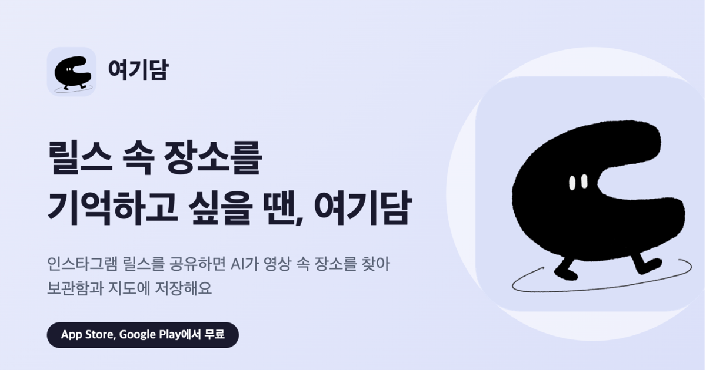

<h1 align="center">여기담</h1>

  <b>릴스에서 본 거기, 어디였더라?</b> 
  인스타그램 릴스를 여기담에 공유하면 AI가 영상 속 장소를 찾아 보관함과 지도에 저장합니다.

  
  &nbsp;
  
   
  <a href="https://yeogidam.vercel.app/?utm_source=github&utm_medium=referral&utm_campaign=github_readme">서비스 소개 페이지</a>

> ▷ 2026년 8월 28일 App Store에 처음 출시했고, 지금은 2.5 버전을 운영합니다. 
> ▷ 팀 계정과 코치 계정을 뺀 147개 계정이 가입했고, 147개 가운데 112개 계정이 릴스를 782회 공유했습니다(2026-11-13 기준). 
> ▷ 정답을 사람이 확인한 국내 게시물의 장소 46곳 가운데 42곳을 찾습니다(2026-11-10 골든셋 평가).

## 목차

1. [어떤 서비스인가요](#어떤-서비스인가요)
2. [왜 만들었나요](#왜-만들었나요)
3. [어떻게 쓰나요](#어떻게-쓰나요)
4. [핵심 기능, 릴스에서 장소 찾기](#핵심-기능-릴스에서-장소-찾기)
5. [가설과 방향 전환](#가설과-방향-전환)
6. [실제로 쓰였다는 근거](#실제로-쓰였다는-근거)
7. [아키텍처](#아키텍처)
8. [기술과 고른 이유](#기술과-고른-이유)
9. [자주 받는 질문](#자주-받는-질문)
10. [더 읽을 문서](#더-읽을-문서)
11. [팀](#팀)

## 어떤 서비스인가요

- 인스타그램에서 릴스를 보다가 공유 버튼으로 여기담을 고르면, 앱을 열지 않아도 장소가 보관함과 지도에 담깁니다.
- 캡션에 가게 이름이 없어도 AI가 영상 속 자막, 화면 속 글자, 말소리까지 읽고, 찾은 이름이 지도에 실제로 있는 장소인지 확인한 뒤에 저장합니다.
- 장소마다 어느 릴스에서 왔는지가 남아서 원본 영상으로 돌아가 다시 볼 수 있고, 지도에서 모아 보다가 주소를 복사하거나 카카오맵이나 구글맵으로 길찾기를 이어 갈 수 있습니다.

## 왜 만들었나요

릴스에서 가고 싶은 곳을 보면 사람들은 저장함, 친구 DM, 캡처, 카톡 나에게 보내기 가운데 발견한 순간 가장 편한 방법으로 일단 저장해 둡니다. 그런데 약속이 생겨 저장해 둔 장소를 다시 찾으려 하면 어디에 저장했는지 기억나지 않고, 썸네일만 보고는 어떤 가게인지 알 수 없어 하나씩 열어 보다가 결국 지도 앱에서 다시 검색합니다. 팀은 이런 문제를 「왜?」를 다섯 번 묻는 5 Whys로 파고들었습니다.

- **보이는 문제**: 저장은 되는데 다시 찾지 못합니다.
- **기억 쪽 원인**: 보던 흐름을 끊기 싫어서 마찰이 가장 적은 방법(대개 DM)으로 저장하다 보니, 저장한 곳이 여러 앱에 흩어집니다.
- **방식 쪽 원인**: 장소 정보가 영상 안에 묻혀 있어 썸네일과 목록으로는 알 수 없고, 맛집과 카페와 여행지가 한 더미에 섞여 이름으로도 찾을 수 없습니다.
- **뿌리 원인**: 저장되는 단위는 영상인데 꺼낼 때 필요한 단위는 장소(이름, 위치)라서, 어느 방법으로 저장하든 다시 찾기 어렵습니다.
- **해결 방향**: 저장하는 순간 영상을 장소로 바꿔 한곳에 모아 주고, 사용자가 저장하는 순간의 수고에 민감하므로 공유 버튼 한 번 말고는 아무것도 요구하지 않습니다.

팀은 앱을 만들기 전에 인스타그램 DM으로 릴스를 받아 팀원이 손으로 장소를 찾아 지도에 옮겨 보내 주는 일을 먼저 해 봤고, 같은 흐름을 앱으로 옮겨 첫 버전을 냈습니다. 첫 버전을 낸 뒤 군자역과 건대입구역에서 직접 물었을 때 39명 가운데 19명이 같은 불편을 겪고 있었습니다. 그런데 앱을 소개받은 19명 가운데 설치한 사람은 1명뿐이어서, 팀은 장소를 처음부터 정확하게 찾아 주지 못하면 다시 쓰지 않는다고 보고 장소를 찾는 정확도부터 다듬기로 했습니다. 이후 과정은 [가설과 방향 전환](#가설과-방향-전환)에 버전별로 적었습니다.

## 어떻게 쓰나요

<table>
  <tr>
    <td align="center">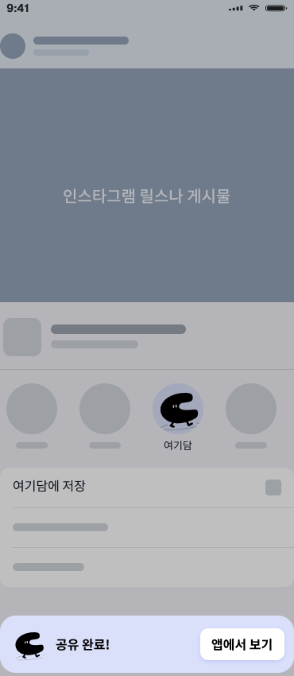</td>
    <td align="center">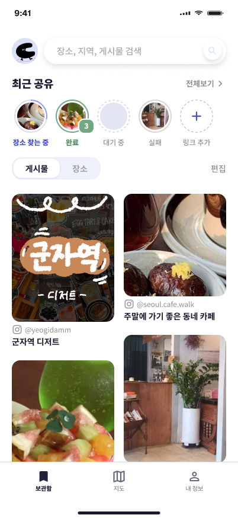</td>
    <td align="center">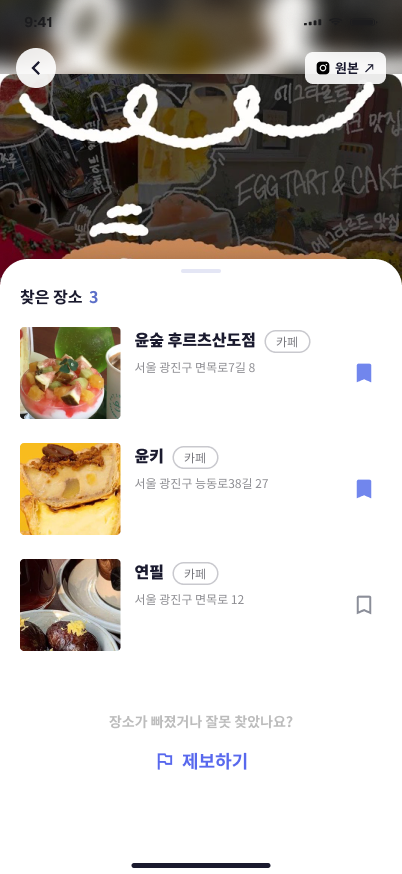</td>
    <td align="center">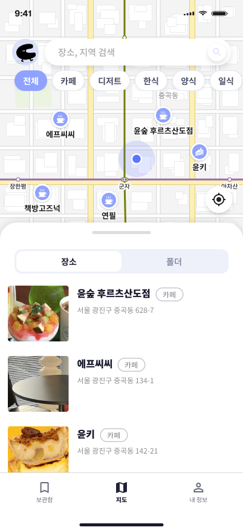</td>
    <td align="center">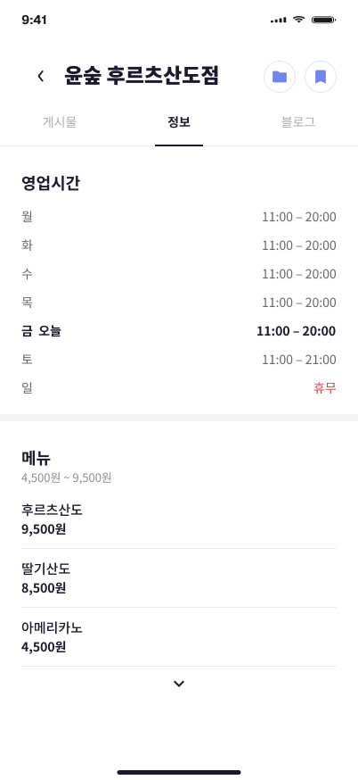</td>
  </tr>
  <tr>
    <td align="center">1. 공유</td>
    <td align="center">2. 확인</td>
    <td align="center">3. 찾은 장소</td>
    <td align="center">4. 지도</td>
    <td align="center">5. 장소 상세</td>
  </tr>
</table>

| 단계 | 하는 일 |
|---|---|
| 1. 공유 | 인스타그램 릴스나 게시물의 공유 버튼을 누르고 여기담을 고르면 화면 아래에 공유 완료 카드가 뜨고, 사용자가 할 일은 끝납니다. 장소는 서버가 뒤에서 찾으므로 인스타그램을 계속 봐도 됩니다. |
| 2. 확인 | 보관함 맨 위 최근 공유에서 장소를 찾는 중인지, 몇 곳을 찾았는지, 실패했는지 봅니다. 실패하면 이유가 함께 나오고 다시 시도할 수 있습니다. |
| 3. 찾은 장소 | 게시물을 누르면 해당 릴스에서 찾은 장소가 모여 있고, 장소마다 북마크를 켜고 끄거나 잘못 찾은 장소를 제보할 수 있습니다. |
| 4. 지도 | 저장한 장소를 지도 위 핀으로 모아 보고, 카테고리 칩과 폴더로 좁혀 봅니다. |
| 5. 장소 상세 | 영업시간, 메뉴, 블로그 글, 출처 릴스를 보고, 주소를 복사하거나 카카오맵이나 구글맵으로 길찾기를 이어 갑니다. |

화면은 앱 2.5.0 코드를 보고 Figma로 다시 그렸으며, 앱의 둘러보기 예시(군자역) 데이터를 넣었습니다. 처음 설치한 사람도 로그인하지 않고 같은 예시로 공유부터 지도까지 먼저 둘러볼 수 있습니다.

## 핵심 기능, 릴스에서 장소 찾기

### 무엇이 어려운가요

- 릴스는 캡션에 가게 이름을 적지 않고 영상 자막이나 말소리로만 소개하는 일이 많습니다. 팀이 만든 국내 평가 묶음 40건 가운데 11건이 그런 게시물입니다.
- 캡션에서는 「성수동」 같은 지역 이름, 지점을 알 수 없는 체인 이름, 장소가 아닌 상품 후기, 가게 대신 들어 있는 주차장이나 전망대를 장소로 착각하지 않게 걸러야 합니다.
- AI가 뽑은 이름에는 오타나 음역이 섞이기 쉬워서, 지도에 실제로 있는 장소인지 확인하지 않으면 엉뚱한 가게가 저장됩니다.

### 어떻게 찾나요

<picture>
  <source media="(prefers-color-scheme: dark)" srcset=".github/readme/extraction-flow-dark.png">
  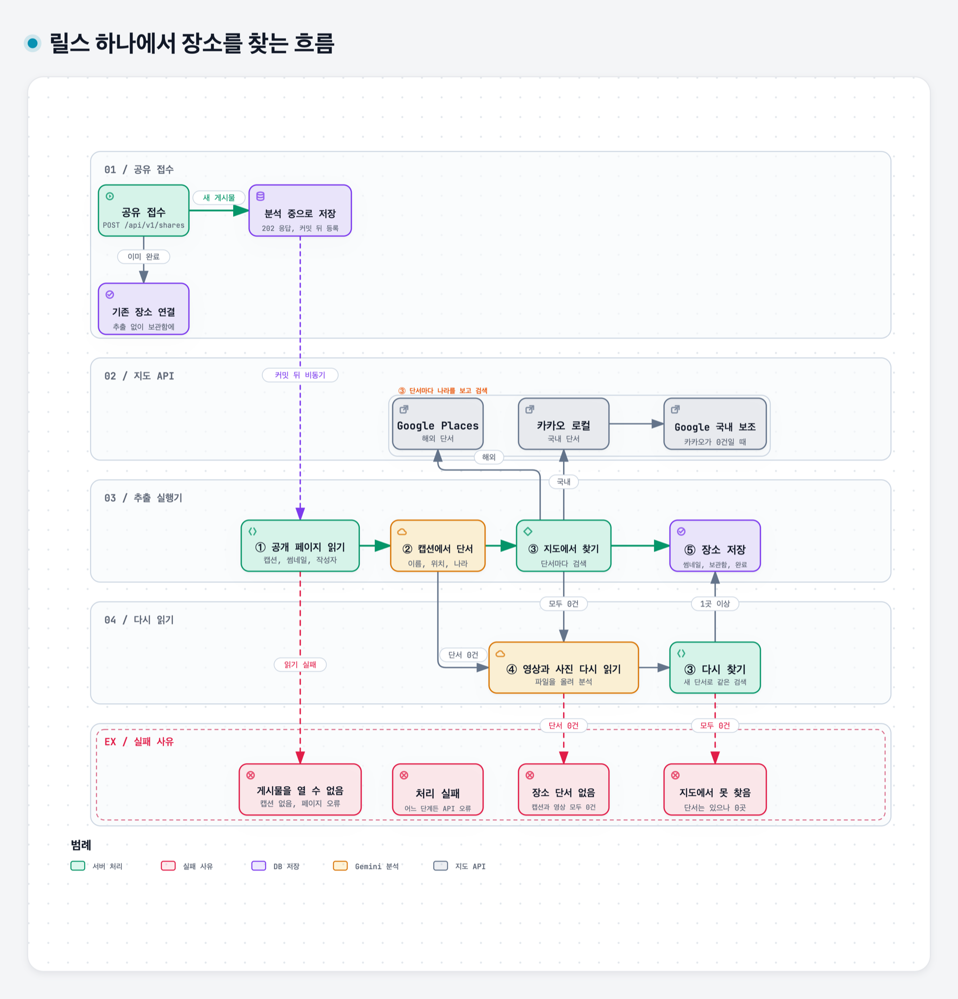
</picture>

1. 공유를 받으면 바로 응답하고, 추출은 서버 안의 별도 스레드 풀에서 이어서 합니다. 같은 게시물을 이미 분석했다면 추출하지 않고 찾아 둔 장소를 바로 연결합니다.
2. 공개 게시물의 캡션과 썸네일을 읽고, Gemini가 캡션에서 장소 단서(이름, 지역, 주소, 나라)를 뽑습니다. 지역 이름, 지점 근거가 없는 체인, 상품 후기, 하위 시설은 장소로 치지 않는다는 규칙을 프롬프트에 둡니다.
3. 국내 단서는 카카오 로컬 검색으로 실제 장소를 확인하고, 카카오가 0건이면 Google에서 한 번 더 찾습니다. 해외 단서는 Google Places로 찾습니다.
4. 캡션에서 단서가 나오지 않거나 검색이 0건이면 영상과 사진을 Gemini에 올려 자막, 화면 속 글자, 말소리를 다시 읽고 3번으로 돌아갑니다.
5. 찾은 장소는 보관함과 지도에 저장하고, 못 찾으면 실패 사유(게시물을 열 수 없음, 장소를 못 찾음, 지도에서 못 찾음 등)를 남깁니다. 사용자가 제보한 실패는 팀이 다시 확인해 장소를 채워 넣습니다.

### 품질은 어떻게 재나요

정답을 미리 적어 둔 게시물 묶음(골든셋)을 운영 코드 그대로 돌려서, 바꾸기 전과 후를 같은 정답으로 잽니다. 외부 API를 부르기 때문에 CI에서는 돌리지 않고 추출 규칙을 바꿀 때마다 손으로 돌립니다.

| 골든셋 | 게시물 | 고른 기준 | 점수에 넣는 정답 |
|---|---|---|---|
| 국내 | 40건(캡션 10, 영상 11, 사진 3, 모음 11, 정답 없음 5) | 다섯 종류를 섞은 표본 | 사람이 캡션, 캐러셀 전체, 영상 2초 간격 프레임을 대조해 확인한 28건의 46곳 |
| 회원 | 57건 | 운영에서 다른 가게가 붙었거나 실패한 회원 공유만 | 확인한 41건의 54곳 |
| 해외 | 24건(해외 21, 국내 대조군 3) | 운영의 해외 게시물 전부 | 사람이 확인한 정답 35곳과 오답 20곳 |

같은 상호의 다른 지점으로 정답을 대신하지 않고, 정답을 다 채우지 못한 게시물은 점수에서 빼서 정답 목록 밖의 예측을 오답으로 단정하지 않습니다.

### 결과

| 골든셋 | 바꾸기 전 | 지금 |
|---|---|---|
| 국내, 정답 46곳 | 39곳, 틀리게 뽑음 6곳(평가를 시작한 기준 커밋) | 42곳, 틀리게 뽑음 1곳 |
| 회원, 정답 54곳 | 27곳(카카오만 검색) | 37곳(카카오가 0건이면 Google에서 한 번 더) |
| 해외, 정답 35곳 | 0곳, 국내 가게가 6곳에 붙음(카카오만 검색) | 32\~34곳, 국내 가게가 붙은 곳 0곳(Google Places) |

- Gemini는 같은 캡션에도 실행마다 조금씩 다른 단서를 내서, 같은 코드로 다시 돌려도 국내 결과가 39\~43곳 사이에서 움직입니다. 그래서 숫자 하나보다 틀리게 뽑은 곳과 게시물 단위 완전 일치(지금 28건 중 24건)를 함께 봅니다.
- 운영에서도 공유가 실패한 비율이 스프린트 1 둘째 주 67%에서 스프린트 4 둘째 주 9.3%로 내려갔습니다(사용자가 공유했을 때의 상태 기준).

<b>시도했다가 접은 방법</b>

| 방법 | 접은 까닭 |
|---|---|
| 영상 원본을 받는 보조 컨테이너(yt-dlp) | 서버 안에서 받는 방법만으로 국내 골든셋 40건 중 38건의 원본을 받았고, 못 받은 2건은 연령 제한이라 보조 컨테이너로도 받을 수 없었습니다. |
| 댓글과 위치 태그를 단서에 더하기 | 더해도 찾은 장소가 늘지 않았습니다. |
| 영상 분석을 OpenAI로 대신하기 | OpenAI API는 영상 입력을 받지 않아서 영상 속 자막과 말소리를 읽을 수 없었습니다. |
| 카카오 반경 검색을 거리순으로 정렬하기 | 같은 건물의 다른 가게가 앞에 와서 결과가 나빠졌고, 반경을 5km로 넓히면 다른 지점이 붙어서 반경 3km와 정확도순 정렬로 돌아갔습니다. |
| 국내 검색을 Google 하나로 바꾸기 | 같은 단서로 견주면 국내 골든셋에서 카카오가 42곳, Google이 31곳을 찾아서, 카카오를 먼저 쓰고 0건일 때만 Google을 부릅니다. |

자세한 규칙과 코드 위치는 [장소 분석 파이프라인](Backend/docs/media-extraction-pipeline.md)과 [골든셋 평가](Backend/eval/README.md)에 있습니다.

## 가설과 방향 전환

2주마다 가설을 하나 세우고, 처음 쓰는 사람과 고정 테스터에게 직접 써 보게 해서 맞는지 확인했습니다. 틀린 가설도 지우지 않고 남겨 두었다가 다음 버전에서 고쳤습니다.

| 버전 | 가설 | 결과 | 본 것과 바꾼 것 |
|---|---|---|---|
| **1.0** 8월 | 손으로 해 보던 일을 앱으로 옮긴다 | 첫 출시 | DM으로 받은 릴스를 팀이 손으로 지도에 옮겨 보낸 흐름을 Supabase 위의 앱으로 만들었습니다. |
| **1.1** 9월 5일 | 같은 불편을 겪은 10명 중 2명은 설치한다 | ✕ 19명 중 1명 설치 | 처음부터 장소를 정확히 찾아야 다시 쓴다고 보고 정확도부터 다듬었습니다. |
| **2.0** 10월 16일 | 처음 쓰는 5명 중 4명 이상이 설명 없이 끝까지 해낸다 | 처음 2명, 고친 뒤 4명 | 찾은 장소를 사용자가 대기함에서 골라 담던 단계를 없애고 자동으로 저장했습니다. |
| **2.1** 10월 23일 | 5명 모두 실수 두 번 안에 공유한다 | ✓ 5명 모두 | 2.0을 다시 잴 때도 4명이 온보딩에서 헤매서 기기별 영상 가이드를 만들었습니다. |
| **2.2** 10월 30일 | 고정 테스터 9명 중 6명 이상이 저장한 장소를 더 빨리 찾는다 | 전후를 잰 4명 중 3명 빨라짐 | 9명 중 3명이 다시 찾기 어렵다고 해서 카테고리 칩과 폴더를 넣었고, 잘못 누른 핀이 21번에서 0번으로 줄었습니다. 9명을 다 재지는 못했습니다. |
| **2.3** 11월 8일 | 릴스로 기억한 장소를 30% 넘게 빨리 찾는다 | ✓ 5명 중 4명 | 고정 테스터가 장소만 늘어선 보관함을 보고 「이게 뭐였지?」라고 해서 릴스 썸네일로 찾는 게시물 탭을 넣었고, 찾는 시간 중앙값이 1분 22초에서 26초로 줄었습니다. |
| **2.4** 11월 10일 | 장소 정보를 앱 안에서 보면 다른 앱으로 덜 나간다 | 확인 중 | 2.2 테스트에서 8명 중 5명이 장소를 다시 확인하러 카카오맵이나 인스타그램으로 나가서, 장소 상세에 영업시간, 메뉴, 블로그 글을 넣었습니다. |

사용자를 데려오는 가설도 같은 방식으로 쟀습니다.

| 실험 | 기준 | 결과 | 배운 것 |
|---|---|---|---|
| 에브리타임 이벤트(10월 26일부터 일주일) | 팀 밖 신규 가입 10명 | ✓ 11명, 11명 가운데 4명이 이벤트가 끝난 뒤 일주일 안에 다시 공유 | 직접 써 볼 계기를 주면 일부는 계속 씁니다. |
| 인스타그램 홍보 게시물(장소 저장 불편을 다룬 게시물 5개) | 프로필 링크 클릭 10회, 다운로드 5명 | ✕ 노출 1,052회, 클릭 0\~1회, 다운로드 0명 | 불편에 공감해도 게시물만 보고는 설치까지 오지 않았습니다. |

### 서버를 Supabase에서 Spring으로 옮긴 까닭

첫 버전은 Supabase(Edge Function, RPC, PostgREST)로 빠르게 만들었지만, 로직이 테이블과 함수 여러 곳에 흩어져 있어서 9월 7일부터 역할과 책임이 분명한 Spring 서버로 다시 짰습니다. 옮기는 도중인 10월 10일에는 Supabase 저장 용량 초과로 모든 요청이 402를 받아 앱 전체가 이틀 넘게 멈추기도 했습니다. 10월 19일에 회원 73명과 공유 611건을 운영 RDS로 옮긴 뒤 Spring을 쓰는 첫 앱 2.0.0을 출시했고, 11월 9일에 Supabase 프로젝트를 모두 내렸습니다.

## 실제로 쓰였다는 근거

팀 계정과 코치 계정을 빼고, 사용성 테스트와 고정 테스터의 공유는 따로 셌습니다. 공유를 한 번 이상 한 사람을 해당 주의 활성 사용자로 보고, 핵심 지표는 주간 공유 수로 잡았습니다. 목표는 사용자 10명이 주 3회씩 공유하는 주 30회였습니다. 아래 숫자와 그래프는 팀이 스프린트마다 낸 유저 데이터 리포트(2026-11-13 기준)에서 가져왔습니다.

### 주간 활성 사용자와 공유 수

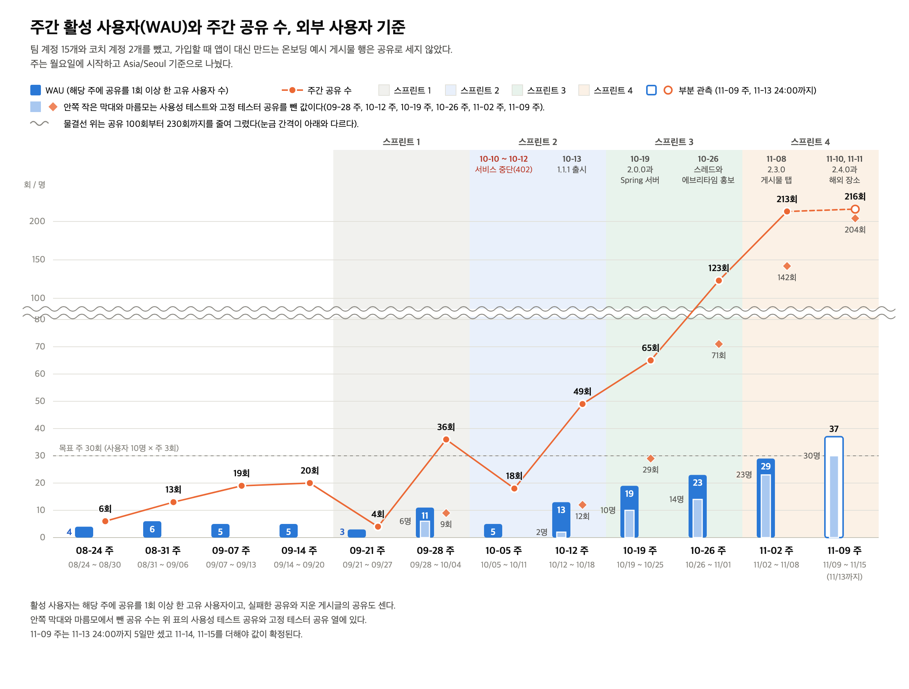

| 항목 (1주 차 / 2주 차) | 스프린트 1 9월 21일\~ | 스프린트 2 10월 5일\~ | 스프린트 3 10월 19일\~ | 스프린트 4 11월 2일\~ |
|---|---|---|---|---|
| 팀 밖 주간 활성 사용자 | 3명 / 11명 | 5명 / 13명 | 19명 / 23명 | 29명 / 37명 |
| 주간 공유 | 4회 / 36회 | 18회 / 49회 | 65회 / 123회 | 213회 / 216회 |
| 테스트 공유를 뺀 주간 공유 | 4회 / 9회 | 18회 / 12회 | 29회 / 71회 | 142회 / 204회 |
| 공유 실패율 | 50% / 67% | 26% / 23% | 12.3% / 13.0% | 13.1% / 9.3% |
| 가입하고 하루 안에 첫 공유 | 9개 중 4개 | 5개 중 2개 | 17개 중 13개 | 52개 중 27개 |

- 스프린트 4 둘째 주는 11월 13일까지 5일만 셌습니다.
- 공유가 몇 사람에게 몰려 있어서 스프린트 4에는 상위 세 계정이 테스트 공유를 뺀 공유의 59%, 56%를 했지만, 세 계정을 빼도 58회, 89회로 목표 30회를 넘었습니다.
- 스프린트 4 둘째 주의 테스트 공유를 뺀 공유 204회 가운데 88회는 이전 주에도 공유한 사람이 했습니다.
- 스프린트 4에 가입한 52개 계정 가운데 19개는 아직 한 번도 공유하지 않아서, 가입 뒤 첫 공유까지 가는 길을 다음에 볼 곳으로 남겨 두었습니다.

### 리텐션

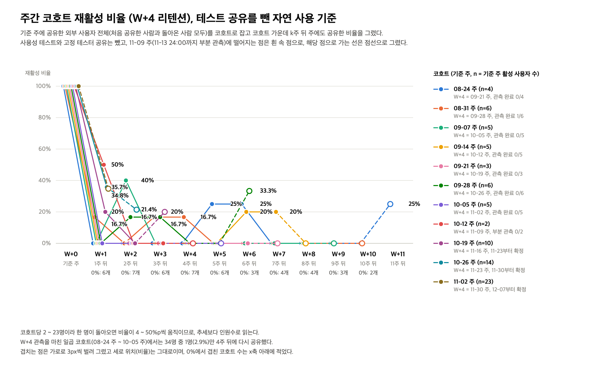

리텐션은 어느 주에 공유한 사람이 몇 주 뒤에도 다시 공유하는 비율로 셉니다(W+1은 1주 뒤, W+4는 4주 뒤).

- **다음 주 재방문(W+1)**: 10월 19일 주 코호트 10명 가운데 2명(20%)에서 10월 26일 주 코호트 14명 가운데 5명(35.7%)으로 올랐고, 11월 2일 주 코호트도 11월 13일까지 23명 가운데 8명이 다시 공유했습니다.
- **4주 뒤 재방문(W+4)**: 관측을 마친 일곱 주 코호트 34명 가운데 1명(2.9%)만 4주 뒤에 다시 공유해서, 오래 남는 사용을 다음 과제로 남겨 두었습니다. 4주가 지난 뒤 5\~11주 만에 돌아와 공유한 사람은 세 코호트에서 나왔습니다.
- **읽는 법**: 코호트가 2\~23명이라 한 명이 돌아오면 비율이 4\~50%p씩 움직여서, 비율의 추세보다 인원수로 읽습니다.

<b>코호트 표 (테스트 공유를 뺀 자연 사용 기준)</b>

| 코호트(기준 주) | n | W+1 | W+2 | W+3 | W+4 | W+4 판정 |
|---|---:|---:|---:|---:|---:|---|
| 8월 24일 주 | 4 | 0 | 0 | 0 | 0 | 0/4, 관측 완료 |
| 8월 31일 주 | 6 | 1 | 0 | 1 | 1 | 1/6, 관측 완료 |
| 9월 7일 주 | 5 | 0 | 2 | 0 | 0 | 0/5, 관측 완료 |
| 9월 14일 주 | 5 | 0 | 0 | 0 | 0 | 0/5, 관측 완료 |
| 9월 21일 주 | 3 | 0 | 0 | 0 | 0 | 0/3, 관측 완료 |
| 9월 28일 주 | 6 | 0 | 1 | 1 | 0 | 0/6, 관측 완료 |
| 10월 5일 주 | 5 | 0 | 0 | 0 | 0 | 0/5, 관측 완료 |
| 10월 12일 주 | 2 | 1 | 0 | 0 | 0* | 0/2, 부분 관측 |
| 10월 19일 주 | 10 | 2 | 0 | 2* | | 11월 23일부터 확정 |
| 10월 26일 주 | 14 | 5 | 3* | | | 11월 30일부터 확정 |
| 11월 2일 주 | 23 | 8* | | | | 12월 7일부터 확정 |

`*`를 단 값은 11월 13일까지 5일만 센 11월 9일 주에 떨어지고, 빈칸으로 둔 주는 아직 오지 않았습니다.

### PMF 설문

앱 2.4.0 안에서 받은 PMF(Product-Market Fit) 설문(「여기담을 더 이상 쓸 수 없다면 어떻겠습니까?」)에는 팀 밖 활성 사용자 9명이 답했고, 4명이 「매우 실망」을 골랐습니다. 최근 2주에 28회 이상 공유한 3명은 모두 「매우 실망」을 골랐지만, 응답자가 9명뿐이라 한 명이 11%p를 움직여서 PMF를 판단하지는 않았습니다.

## 아키텍처

<picture>
  <source media="(prefers-color-scheme: dark)" srcset=".github/readme/architecture-dark.png">
  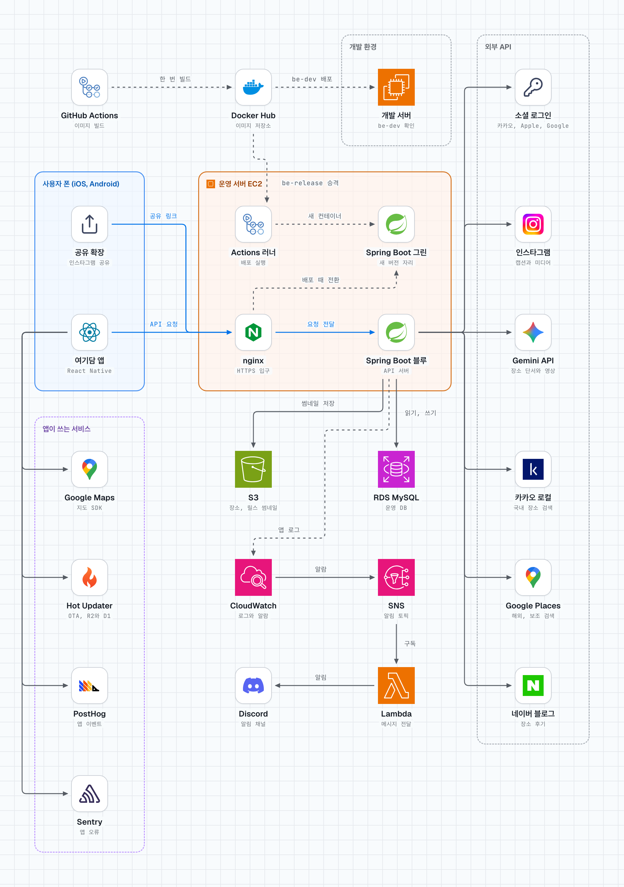
</picture>

구조도에는 사용자 요청을 파란 실선으로, 서버가 부르는 곳과 알림을 회색 실선으로, 배포와 로그 전송을 회색 점선으로 그렸습니다.

- **요청 흐름**: 앱과 공유 확장의 요청은 nginx를 거쳐 Spring Boot로 가고, 데이터는 RDS MySQL, 썸네일은 S3에 둡니다. 공유는 바로 202로 받고 추출은 서버 안에서 비동기로 이어 가며, 메타데이터 풀과 분석 풀을 나눠 느린 영상 분석이 캡션과 썸네일 저장을 막지 않게 했습니다.
- **배포**: GitHub Actions가 이미지를 한 번 만들어 Docker Hub에 올리고, 같은 이미지를 개발 서버에서 운영 서버로 승격합니다. 운영 서버의 배포 전용 러너가 새 컨테이너를 빈 칸에 띄운 뒤 nginx를 넘겨 블루그린으로 교대합니다.
- **관측**: 컨테이너 로그를 CloudWatch로 보내고, 지표 필터와 알람이 SNS와 Lambda를 거쳐 디스코드로 알립니다. 장소 추출 실패는 한 건이어도 알림이 옵니다.
- **브랜치**: 서버와 앱이 서로의 배포를 막지 않게 분야마다 개발 브랜치(be-dev, fe-dev)와 출시 브랜치(be-release, fe-release)를 두고, main은 실제로 나간 것의 스냅샷으로만 씁니다.

<b>공유 한 번이 지나가는 길</b>

<picture>
  <source media="(prefers-color-scheme: dark)" srcset=".github/readme/share-sequence-dark.png">
  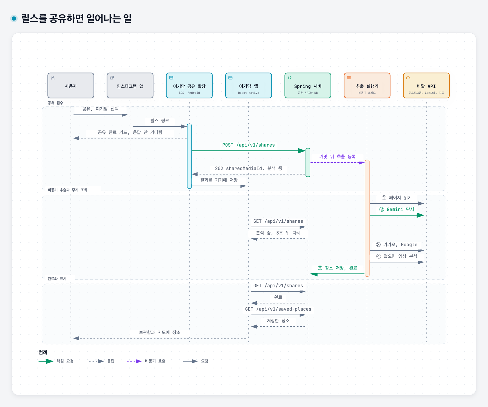
</picture>

## 기술과 고른 이유

문서 칸의 ADR(Architecture Decision Record)은 팀이 고른 방법과 버린 대안을 함께 남긴 설계 결정 기록입니다.

| 구분 | 기술 | 고른 이유 | 문서 |
|---|---|---|---|
| 서버 | Java 21, Spring Boot 4.1, Spring JDBC | Supabase 테이블과 함수에 흩어진 로직을 역할이 분명한 객체 구조로 옮기려고 골랐습니다. | [전환 로드맵](Backend/docs/migration-roadmap.md) |
| DB | MySQL 8.4(RDS), Flyway | 스키마 변경을 버전 SQL로 남겨 개발과 운영에 같은 순서로 적용합니다. | [Flyway](Backend/docs/flyway.md) |
| AI | Gemini API | 영상을 그대로 받아 캡션, 자막, 화면 속 글자, 말소리를 한 모델로 읽을 수 있습니다. 무료 키를 먼저 쓰고 막히면 결제 키로 넘어갑니다. | [파이프라인](Backend/docs/media-extraction-pipeline.md) |
| 검색 | 카카오 로컬 API, Google Places API | 국내는 같은 단서로 카카오가 Google보다 많이 맞혀서(46곳 중 42곳과 31곳) 카카오를 먼저 쓰고, 카카오가 다루지 않는 해외는 Google을 씁니다. | [골든셋 평가](Backend/eval/README.md) |
| 인프라 | AWS EC2(ARM t4g), RDS, S3 | 운영 비용을 줄이고 CI가 만든 ARM 이미지를 고치지 않고 실행하려고 골랐습니다. | [인프라 ADR-03](Backend/docs/infra/adr-03-ec2-architecture.md) |
| 배포 | GitHub Actions, Docker Hub, 셀프호스티드 러너 | CI는 GitHub 러너, CD는 운영 서버의 배포 전용 러너로 나눠 운영 서버에 빌드 부하를 주지 않고, 이미지를 한 번 만들어 같은 digest를 승격합니다. | [ADR-01](Backend/docs/infra/adr-01-docker-image-identity.md), [ADR-02](Backend/docs/infra/adr-02-cicd-execution.md) |
| 무중단 | nginx와 같은 서버 블루그린 | 로드밸런서와 서버 두 대는 예산을 넘고 CodeDeploy는 계정 권한으로 쓸 수 없어서, 한 서버 안에서 컨테이너를 교대합니다. | [인프라 현재 상태](Backend/docs/infra/current-state.md) |
| 관측 | CloudWatch, SNS, Lambda, Discord | 팀이 매일 보는 디스코드로 알람을 받습니다. | [운영 관찰과 대응](Backend/docs/infra/observability.md) |
| 후기 | 네이버 블로그 검색 API | 2.2 테스트에서 장소를 다시 확인하러 다른 앱으로 나가는 사람이 많아서, 장소 상세에서 블로그 글을 바로 보여 줍니다. | |
| 지도 | Google Maps SDK | 해외 장소까지 한 지도에 그리고, Google Places 결과는 Google 지도 위에서만 보여 줘야 한다는 약관을 지키려고 2.5에서 카카오 지도를 바꿨습니다. | |
| 앱 | React Native 0.86, TypeScript | iOS와 Android를 한 코드로 만들고, 인스타그램에서 부르는 공유 확장만 플랫폼별로 둡니다. | [앱 README](Frontend/README.md) |
| OTA | Hot Updater(Cloudflare R2, D1) | 스토어 심사 없이 JavaScript 변경을 OTA(Over-the-Air) 업데이트로 내보냅니다(2.2.0부터). | |
| 분석 | PostHog, Sentry | 앱 이벤트로 가설의 지표를 재고, 앱과 공유 확장의 오류를 모읍니다. | |

## 자주 받는 질문

<b>운영 비용은 어떻게 줄였나요?</b>

우아한테크코스가 정한 AWS 월 비용 한도 안에서 운영하려고 로드밸런서 없이 한 서버 안에서 블루그린으로 배포하고, ARM 인스턴스를 씁니다. Gemini는 무료 키를 먼저 쓰고 한도에 막힐 때만 결제 키로 넘어가며, Google Places는 지금 규모(월 수백 건)에서 무료 사용량 안에 듭니다.

<b>데이터는 어디서 어떻게 모으나요?</b>

사용자가 공유한 공개 게시물의 캡션과 미디어만 읽고, 로그인이 필요한 정보는 읽지 않습니다. 영상은 장소를 찾는 데만 쓰고 저장하지 않으며, 릴스 링크와 썸네일, 찾은 장소 정보만 보관합니다. 앱 사용 분석은 PostHog 이벤트로 하고, 화면 자동 수집과 세션 녹화는 꺼 두었습니다.

<b>품질은 어떻게 확인하나요?</b>

- 장소 추출은 [골든셋](Backend/eval/README.md) 세 가지로 바꾸기 전과 후를 같은 정답으로 잽니다.
- 서버는 도메인 단위 테스트와, Testcontainers MySQL 위에서 도는 DAO, 서비스 통합, API 테스트로 나눠 검증하고, 테스트 메서드는 908개입니다(be-dev 기준).
- 운영에서는 공유 실패율을 매주 세고, 사용자가 제보한 실패는 팀이 다시 확인해 장소를 채워 넣습니다.

<b>배포할 때 앱이 끊기지 않나요?</b>

예전 배포 방식은 운영 출시 때 16초 동안 끊겨 요청 1,740건 가운데 81건이 502를 받았습니다. 블루그린으로 바꾼 첫 운영 출시(10월 30일)에서는 밖에서 계속 보낸 요청 2,084건이 모두 성공했고, 같은 날 직전 버전으로 되돌리는 롤백도 운영에서 한 번 해 봤습니다.

<b>장애는 어떻게 알아차리나요?</b>

컨테이너 로그를 CloudWatch로 모으고, 5xx 응답, 앱 오류, 디스크 사용률 알람이 디스코드로 옵니다. 장소 추출 실패는 한 건이어도 알림이 오고, 앱 쪽 오류는 Sentry에 모입니다.

## 더 읽을 문서

| 문서 | 내용 |
|---|---|
| [장소 분석 파이프라인](Backend/docs/media-extraction-pipeline.md) | 공유 접수부터 장소 저장까지의 규칙과 코드 위치 |
| [골든셋 평가](Backend/eval/README.md) | 정답을 정한 방법, 채점 규칙, 실행별 결과와 검색 출처 비교 |
| [ADR-01 InstagramUrl 모델링](Backend/docs/adr-01-instagram-url-modeling.md), [ADR-02 게시글 삭제와 장소 선택](Backend/docs/adr-02-post-delete-and-place-selection.md) | 도메인 설계 결정 |
| [인프라 문서](Backend/docs/infra/README.md) | 인프라 ADR 다섯 개, 현재 상태, 관측과 대응 |
| [Flyway](Backend/docs/flyway.md) | DB 구조를 바꾸는 순서와 실패했을 때 되돌리는 법 |
| [에러 응답과 로그 계약](Backend/docs/error-contract.md) | 응답 모양과 로그 규칙 |
| [랜딩페이지](Landing/README.md) | 서비스 소개 페이지의 구성과 검증 |
| [앱](Frontend/README.md) | React Native 앱의 환경 변수와 실행 |

## 팀

|  |  |  |  |  |
|:---:|:---:|:---:|:---:|:---:|
| 정콩 | 러키 | 엠버 | 포도 | 두부 |
| [@xxbeann](https://github.com/xxbeann) | [@Jiihyun](https://github.com/Jiihyun) | [@nadajinny](https://github.com/nadajinny) | [@goodsmell](https://github.com/goodsmell) | [@boboyoii](https://github.com/boboyoii) |
| 백엔드 | 백엔드 | 앱 | 앱 | 앱 |

여기담은 우아한테크코스 8기 레벨 3, 4 팀 프로젝트로 만들었습니다.
